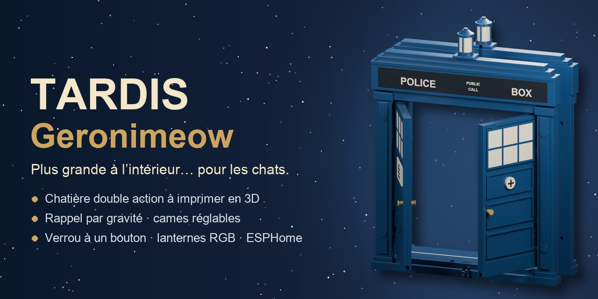
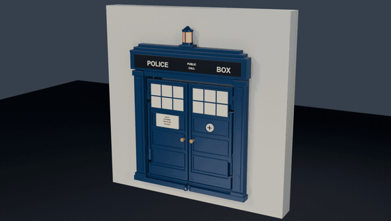

# TARDIS Geronimeow — chatière TARDIS à imprimer en 3D

**[English version](README.md)**



**[Télécharger](#télécharger)** · **[Démarrage rapide](#démarrage-rapide)** · **[Guide complet](tardis_v8/README.md)** ·
**[Liste d'achat](docs/IMPRESSION_ET_MONTAGE.md#liste-dachat)** · **[FAQ](#faq)**

Une chatière en forme de cabine de police, avec une façade TARDIS **de chaque côté de
la porte**. Elle est conçue pour une imprimante multicolore (mise au point sur une
Creality K1 Max avec CFS) et fournie en projets Creality Print prêts à trancher.

> [!WARNING]
> **Prototype non encore imprimé.** Tous les plateaux se tranchent sans avertissement
> dans Creality Print 7.3.1 et la mécanique est contrôlée numériquement (collisions,
> débattement, verrou). **Aucune pièce n'a encore été imprimée.** Commencez par
> l'éprouvette de 20 minutes et le prototype mécanique 1:1, et racontez-nous le
> résultat dans un [retour d'impression](../../issues/new/choose).

## Points forts

- **Deux battants double action** qui reviennent au centre **par gravité**, sans
  ressort : une came en V soulève chaque battant quand il s'ouvre.
- **Force de rappel réglable** : trois cames interchangeables (3,5, 4,5 et 5,5 mm de
  levée), changées en quelques secondes.
- **Verrou central à un bouton** : une lame imprimée bloque les deux battants (LIBRE /
  FERMÉ).
- **Aimants anti-vent**, dont la force se règle avec des cales imprimées de 1 mm.
- **Éclairage connecté en option** : deux lanternes RGB et un capteur de passage (ILS)
  pilotés par un ESP32 caché sous le tunnel. Configuration ESPHome fournie (Home
  Assistant), WLED possible.
- **Gabarit imprimé** pour découper et percer la porte.
- Quatre couleurs : bleu TARDIS, ivoire, noir et laiton.



[Vidéo complète du montage (MP4, 78 s)](tardis_v8/visualisations/montage_complet_V8.mp4) ·
[vue fermée](tardis_v8/01_vue_fermee.png) · [vue ouverte](tardis_v8/02_vue_ouverte.png) ·
[vue arrière](tardis_v8/03_vue_arriere_fermee.png)

## Dimensions principales

| | |
|---|---|
| Passage (tunnel) | 190 × 200 mm |
| Chaque façade | 244 × 314,5 mm (avec la lanterne) |
| Épaisseur de porte | 40 mm par défaut (modifier `door_depth` et régénérer) |
| Découpe de la porte | 196,2 × 206,2 mm + encoche de 36 × 11 mm, au gabarit imprimé |
| Impression | 12 plateaux, chacun dans 300 × 295 mm |

## Ce qu'il faut

- Une imprimante **4 couleurs** (ou des changements de filament à la main), avec un
  plateau d'au moins **285 × 252 mm** pour les façades. Les projets 3MF visent une
  **Creality K1 Max** avec **Creality Print 7.3.1** ; les STL servent aux autres
  logiciels.
- Environ **880 g de PLA** (surtout bleu) et un peu de TPU pour les butées.
- Quincaillerie : tiges acier Ø3 mm, clips, aimants Ø6 mm, vis M3 et M4. Voir la
  [liste d'achat](docs/IMPRESSION_ET_MONTAGE.md#liste-dachat).
- Électronique en option : ESP32-C3 SuperMini, deux LED WS2812B 5 mm, deux ILS.

## Télécharger

- **Plateaux prêts à trancher** (projets Creality Print 3MF) et **toutes les pièces en
  STL** : fichiers zip de la [dernière version publiée](../../releases/latest), ou
  dossiers [`tardis_v8/3mf/`](tardis_v8/3mf/) et [`tardis_v8/stl/`](tardis_v8/stl/).
- **Configuration ESPHome** : [`tardis_v8/esphome/`](tardis_v8/esphome/).

## Démarrage rapide

1. Mesurer la porte. Les fichiers supposent **40 mm** ; les vis M4 en dépendent.
2. Imprimer `00_Eprouvette_jeux` et `01_Prototype_mecanique_75mm`. Vérifier les
   ajustements, choisir la came qui donne le rappel voulu et régler les aimants.
3. Imprimer les autres plateaux de [`tardis_v8/3mf/`](tardis_v8/3mf/), en suivant le
   [guide illustré Creality Print](docs/GUIDE_CREALITY_PRINT.md).
4. Découper la porte au gabarit, puis monter :
   [impression, fournitures et montage](docs/IMPRESSION_ET_MONTAGE.md).
5. Faire au moins **50 cycles à la main**, dans les deux modes, avant de laisser le
   chat seul avec.

## FAQ

**Faut-il une imprimante Creality ?** Non. Les projets 3MF sont réglés pour une Creality
K1 Max avec CFS et Creality Print, et devraient aussi s'ouvrir dans OrcaSlicer et
Bambu Studio (même famille de 3MF, non testé). Avec un autre logiciel, utiliser les STL
et les conseils d'orientation du [guide d'impression](docs/IMPRESSION_ET_MONTAGE.md#préparer-limpression).

**Je n'ai qu'une imprimante monocouleur.** Ça marche : tout imprimer en bleu et peindre
fenêtres, enseigne et boutons (les couleurs sont incrustées côte à côte sur les mêmes
couches, une pause pour changer de filament ne suffit donc pas). La mécanique ne dépend
pas des couleurs.

**Ma porte ne fait pas 40 mm.** Modifier `door_depth` en tête de
`tardis_v8/generate.py` et régénérer (le tunnel suit), voir
[Développement](docs/DEVELOPPEMENT.md). Prévoir des vis M4 de la bonne longueur.

**Est-ce assez grand pour mon chat ?** Le passage fait 190 × 200 mm, plus que la plupart
des chatières du commerce. Pour un très grand chat (Maine Coon), la taille du passage
est un paramètre, mais moulures, perçages et jeux sont alors à revérifier.

**L'électronique est-elle obligatoire ?** Non. Éclairage et capteur sont facultatifs ;
sans eux, le berceau et les rainures restent vides.

**Lit-elle les puces électroniques ?** Non. Ce n'est pas une chatière sélective : en
FERMÉ personne ne passe, en LIBRE tout le monde passe.

**Le PLA tient-il dehors ?** Le PLA ramollit vers 55 °C. Sur une porte en plein soleil,
imprimer au moins la façade extérieure en PETG ou en ASA (et vérifier les jeux avec
l'éprouvette dans cette matière). Pas encore testé.

**Puis-je vendre des impressions ?** Non. Les modèles sont sous licence non commerciale,
et TARDIS est une marque de la BBC.

## Documentation

- [Guide V8 complet](tardis_v8/README.md) : cames, verrou, aimants, câblage, ESPHome,
  gabarit, plateaux
- [Guide illustré Creality Print](docs/GUIDE_CREALITY_PRINT.md)
- [Impression, liste d'achat et montage](docs/IMPRESSION_ET_MONTAGE.md)
- [Choix de conception et limites](docs/CONCEPTION.md)
- [Vérifications et ce qui reste à valider](docs/VALIDATION.md)
- [Régénérer le modèle, les figures et la vidéo](docs/DEVELOPPEMENT.md)
- [Historique de la conception](docs/HISTORIQUE.md)
- [Provenance et références](docs/PROVENANCE.md)

## Organisation du dépôt

```
tardis_v8/
  3mf/            12 projets Creality Print prêts à trancher
  stl/            toutes les pièces en STL
  esphome/        configuration ESPHome (lumières, capteur, compteur)
  generate.py     modèle paramétrique (Blender 5)
  images/         figures des guides
  visualisations/ vidéo et GIF de montage
docs/             guides en français, versions anglaises dans docs/en/
scripts/          contrôles de tranchage, figures, export des projets Creality
```

Tout le modèle est généré par code : changer un paramètre de `tardis_v8/generate.py`
(épaisseur de porte, taille du passage, jeux) puis tout reconstruire, voir
[Développement](docs/DEVELOPPEMENT.md).

## Contribuer

Retours d'impression, photos, mesures de jeux et corrections sont les bienvenus. Voir
[CONTRIBUTING.md](CONTRIBUTING.md) et le [code de conduite](CODE_OF_CONDUCT.md).

## Sécurité

C'est une porte que votre animal utilisera seul. Vérifiez qu'aucun battant ne peut
pincer une patte ou une queue, que le verrou ne peut pas s'enclencher tout seul, et
testez longuement avant usage. L'électronique fonctionne uniquement en 5 V USB. La
fabrication et l'usage se font sous votre responsabilité.

## Licence et crédits

- Modèles, images et documentation : **CC BY-NC-SA 4.0**. Code : **MIT**. Voir
  [LICENSE.md](LICENSE.md).
- Inspiré du [TARDIS Deluxe Kit](https://www.thingiverse.com/thing:124033) de
  countspatula (CC BY-NC-SA 3.0). Aucun de ses fichiers n'est réutilisé : voir la
  [provenance](docs/PROVENANCE.md).
- TARDIS, DOCTOR WHO et POLICE BOX sont des marques de la BBC. Ce projet de fan non
  commercial n'est ni affilié à la BBC ni approuvé par elle.
