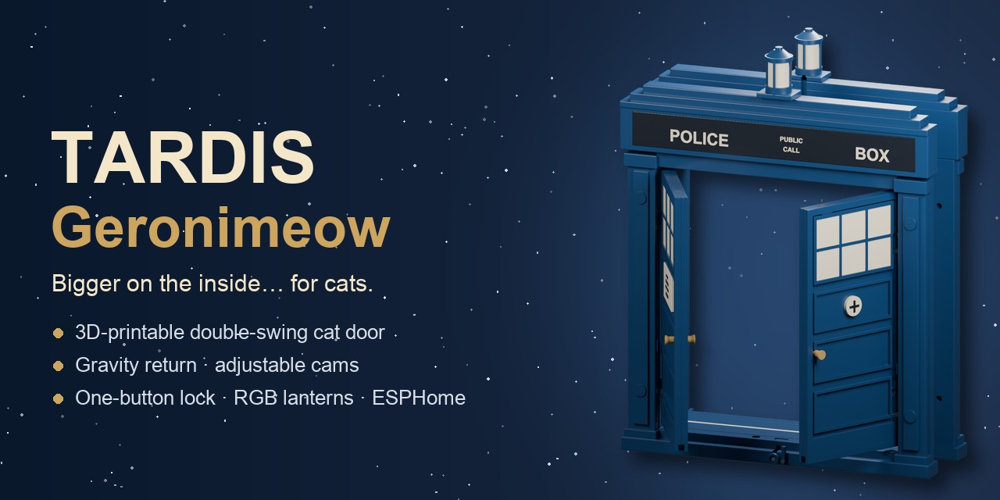

# TARDIS Geronimeow — chatière TARDIS à imprimer en 3D

*A 3D-printable TARDIS cat door* · **Français** · **[English below](#english-version)**

[](LICENSE.md)
[](LICENSE-CODE)
[](../../releases/latest)
[](#version-française)
[](docs/GUIDE_CREALITY_PRINT.md)
[](tardis_v8/esphome/)


## Sommaire / Contents

- **[Version française](#version-française)**
  - [Points forts](#points-forts)
  - [Dimensions principales](#dimensions-principales)
  - [Ce qu'il faut](#ce-quil-faut)
  - [Télécharger](#télécharger)
  - [Démarrage rapide](#démarrage-rapide)
  - [FAQ](#faq)
  - [Documentation](#documentation)
  - [Organisation du dépôt](#organisation-du-dépôt)
  - [Contribuer](#contribuer)
  - [Sécurité](#sécurité)
  - [Licence et crédits](#licence-et-crédits)
- **[English version](#english-version)**
  - [Features](#features)
  - [Key dimensions](#key-dimensions)
  - [What you need](#what-you-need)
  - [Download](#download)
  - [Quick start](#quick-start)
  - [Frequently asked questions](#frequently-asked-questions)
  - [Guides](#guides)
  - [Repository layout](#repository-layout)
  - [Contributing](#contributing)
  - [Safety](#safety)
  - [License and credits](#license-and-credits)

---

## Version française

**[Télécharger](#télécharger)** · **[Démarrage rapide](#démarrage-rapide)** · **[Guide complet](tardis_v8/README.md)** ·
**[Liste d'achat](docs/IMPRESSION_ET_MONTAGE.md#liste-dachat)** · **[FAQ](#faq)**

Une chatière en forme de cabine de police, avec une façade TARDIS **de chaque côté de
la porte**. Elle est conçue pour une imprimante multicolore (mise au point sur une
Creality K1 Max avec CFS) et fournie en projets Creality Print prêts à trancher.

> [!WARNING]
> **Prototype non encore imprimé.** Tous les plateaux se tranchent sans avertissement
> dans Creality Print 7.3.1 et la mécanique est contrôlée numériquement (collisions,
> débattement, verrou). **Aucune pièce n'a encore été imprimée.** Commencez par
> l'éprouvette de 20 minutes et le prototype mécanique 1:1, et racontez-nous le
> résultat dans un [retour d'impression](../../issues/new/choose).

### Points forts

- **Deux battants double action** qui reviennent au centre **par gravité**, sans
  ressort : une came en V soulève chaque battant quand il s'ouvre.
- **Force de rappel réglable** : trois cames interchangeables (3,5, 4,5 et 5,5 mm de
  levée), changées en quelques secondes.
- **Verrou central à un bouton** : une lame imprimée bloque les deux battants (LIBRE /
  FERMÉ).
- **Aimants anti-vent**, dont la force se règle avec des cales imprimées de 1 mm.
- **Éclairage connecté en option** : deux lanternes RGB et un capteur de passage (ILS)
  pilotés par un ESP32 caché sous le tunnel. Configuration ESPHome fournie (Home
  Assistant), WLED possible.
- **Gabarit imprimé** pour découper et percer la porte.
- Quatre couleurs : bleu TARDIS, ivoire, noir et laiton.


[Vidéo complète du montage (MP4, 78 s)](tardis_v8/visualisations/montage_complet_V8.mp4) ·
[vue fermée](tardis_v8/01_vue_fermee.png) · [vue ouverte](tardis_v8/02_vue_ouverte.png) ·
[vue arrière](tardis_v8/03_vue_arriere_fermee.png)

### Dimensions principales

| | |
|---|---|
| Passage (tunnel) | 190 × 200 mm |
| Chaque façade | 244 × 314,5 mm (avec la lanterne) |
| Épaisseur de porte | 40 mm par défaut (modifier `door_depth` et régénérer) |
| Découpe de la porte | 196,2 × 206,2 mm + encoche de 36 × 11 mm, au gabarit imprimé |
| Impression | 12 plateaux, chacun dans 300 × 295 mm |

### Ce qu'il faut

- Une imprimante **4 couleurs** (ou monocouleur et un peu de peinture, voir la
  [FAQ](#faq)), avec un plateau d'au moins **285 × 252 mm** pour les façades. Les projets 3MF visent une
  **Creality K1 Max** avec **Creality Print 7.3.1** ; les STL servent aux autres
  logiciels.
- Environ **880 g de PLA** (surtout bleu) et un peu de TPU pour les butées.
- Quincaillerie : tiges acier Ø3 mm, clips, aimants Ø6 mm, vis M3 et M4. Voir la
  [liste d'achat](docs/IMPRESSION_ET_MONTAGE.md#liste-dachat).
- Électronique en option : ESP32-C3 SuperMini, deux LED WS2812B 5 mm, deux ILS.

### Télécharger

- **Plateaux prêts à trancher** (projets Creality Print 3MF) et **toutes les pièces en
  STL** : fichiers zip de la [dernière version publiée](../../releases/latest), ou
  dossiers [`tardis_v8/3mf/`](tardis_v8/3mf/) et [`tardis_v8/stl/`](tardis_v8/stl/).
- **Configuration ESPHome** : [`tardis_v8/esphome/`](tardis_v8/esphome/).

### Démarrage rapide

1. Mesurer la porte. Les fichiers supposent **40 mm** ; les vis M4 en dépendent.
2. Imprimer `00_Eprouvette_jeux` et `01_Prototype_mecanique_75mm`. Vérifier les
   ajustements, choisir la came qui donne le rappel voulu et régler les aimants.
3. Imprimer les autres plateaux de [`tardis_v8/3mf/`](tardis_v8/3mf/), en suivant le
   [guide illustré Creality Print](docs/GUIDE_CREALITY_PRINT.md).
4. Découper la porte au gabarit, puis monter :
   [impression, fournitures et montage](docs/IMPRESSION_ET_MONTAGE.md).
5. Faire au moins **50 cycles à la main**, dans les deux modes, avant de laisser le
   chat seul avec.

### FAQ

**Faut-il une imprimante Creality ?** Non. Les projets 3MF sont réglés pour une Creality
K1 Max avec CFS et Creality Print, et devraient aussi s'ouvrir dans OrcaSlicer et
Bambu Studio (même famille de 3MF, non testé). Avec un autre logiciel, utiliser les STL
et les conseils d'orientation du [guide d'impression](docs/IMPRESSION_ET_MONTAGE.md#préparer-limpression).

**Je n'ai qu'une imprimante monocouleur.** Ça marche : tout imprimer en bleu et peindre
fenêtres, enseigne et boutons (les couleurs sont incrustées côte à côte sur les mêmes
couches, une pause pour changer de filament ne suffit donc pas). La mécanique ne dépend
pas des couleurs.

**Ma porte ne fait pas 40 mm.** Modifier `door_depth` en tête de
`tardis_v8/generate.py` et régénérer (le tunnel suit), voir
[Développement](docs/DEVELOPPEMENT.md). Prévoir des vis M4 de la bonne longueur.

**Est-ce assez grand pour mon chat ?** Le passage fait 190 × 200 mm, plus que la plupart
des chatières du commerce. Pour un très grand chat (Maine Coon), la taille du passage
est un paramètre, mais moulures, perçages et jeux sont alors à revérifier.

**L'électronique est-elle obligatoire ?** Non. Éclairage et capteur sont facultatifs ;
sans eux, le berceau et les rainures restent vides.

**Lit-elle les puces électroniques ?** Non. Ce n'est pas une chatière sélective : en
FERMÉ personne ne passe, en LIBRE tout le monde passe.

**Le PLA tient-il dehors ?** Le PLA ramollit vers 55 °C. Sur une porte en plein soleil,
imprimer au moins la façade extérieure en PETG ou en ASA (et vérifier les jeux avec
l'éprouvette dans cette matière). Pas encore testé.

**Puis-je vendre des impressions ?** Non. Les modèles sont sous licence non commerciale,
et TARDIS est une marque de la BBC.

### Documentation

- [Guide V8 complet](tardis_v8/README.md) : cames, verrou, aimants, câblage, ESPHome,
  gabarit, plateaux
- [Guide illustré Creality Print](docs/GUIDE_CREALITY_PRINT.md)
- [Impression, liste d'achat et montage](docs/IMPRESSION_ET_MONTAGE.md)
- [Choix de conception et limites](docs/CONCEPTION.md)
- [Vérifications et ce qui reste à valider](docs/VALIDATION.md)
- [Régénérer le modèle, les figures et la vidéo](docs/DEVELOPPEMENT.md)
- [Historique de la conception](docs/HISTORIQUE.md)
- [Provenance et références](docs/PROVENANCE.md)

### Organisation du dépôt

```
tardis_v8/
  3mf/            12 projets Creality Print prêts à trancher
  stl/            toutes les pièces en STL
  esphome/        configuration ESPHome (lumières, capteur, compteur)
  generate.py     modèle paramétrique (Blender 5)
  images/         figures des guides
  visualisations/ vidéo et GIF de montage
docs/             guides en français, versions anglaises dans docs/en/
scripts/          contrôles de tranchage, figures, export des projets Creality
```

Tout le modèle est généré par code : changer un paramètre de `tardis_v8/generate.py`
(épaisseur de porte, taille du passage, jeux) puis tout reconstruire, voir
[Développement](docs/DEVELOPPEMENT.md).

### Contribuer

Retours d'impression, photos, mesures de jeux et corrections sont les bienvenus. Voir
[CONTRIBUTING.md](CONTRIBUTING.md) et le [code de conduite](CODE_OF_CONDUCT.md).

### Sécurité

C'est une porte que votre animal utilisera seul. Vérifiez qu'aucun battant ne peut
pincer une patte ou une queue, que le verrou ne peut pas s'enclencher tout seul, et
testez longuement avant usage. L'électronique fonctionne uniquement en 5 V USB. La
fabrication et l'usage se font sous votre responsabilité.

### Licence et crédits

- Modèles, images et documentation : **CC BY-NC-SA 4.0**. Code : **MIT**. Voir
  [LICENSE.md](LICENSE.md).
- Inspiré du [TARDIS Deluxe Kit](https://www.thingiverse.com/thing:124033) de
  countspatula (CC BY-NC-SA 3.0). Aucun de ses fichiers n'est réutilisé : voir la
  [provenance](docs/PROVENANCE.md).
- TARDIS, DOCTOR WHO et POLICE BOX sont des marques de la BBC. Ce projet de fan non
  commercial n'est ni affilié à la BBC ni approuvé par elle.

---

## English version



**[Download](#download)** · **[Quick start](#quick-start)** · **[Full guide](tardis_v8/README.en.md)** ·
**[Shopping list](docs/en/PRINTING_AND_ASSEMBLY.md#shopping-list)** · **[FAQ](#frequently-asked-questions)**

A cat door (cat flap) that looks like a police box, with a TARDIS front **on both sides of the
door**. It is designed for a multicolour printer (developed on a Creality K1 Max with
CFS) and ships as ready-to-slice Creality Print projects.

> [!WARNING]
> **Untested prototype.** Every plate slices cleanly in Creality Print 7.3.1 and the
> mechanism is checked numerically (collisions, swing, lock). **No part has been printed
> yet.** Start with the 20-minute test coupon and the 1:1 mechanical prototype, and tell
> us how it went in a [print report](../../issues/new/choose).

### Features

- **Two double-swing flaps** that come back to centre **by gravity**, with no spring:
  a V-shaped cam lifts each flap as it opens.
- **Adjustable return force**: three interchangeable cams (3.5, 4.5 and 5.5 mm rise),
  swapped in seconds.
- **One-button central lock**: a printed blade locks both flaps (FREE / LOCKED).
- **Wind-proof magnets**, with the holding force set by 1 mm printed shims.
- **Optional smart lighting**: two RGB lanterns and a passage sensor (reed switches)
  driven by an ESP32 hidden under the tunnel. ESPHome config included (Home Assistant),
  WLED also works.
- **Printed door template** for cutting and drilling the door.
- Four colours: TARDIS blue, ivory, black and brass.


[Full assembly video (MP4, 78 s)](tardis_v8/visualisations/montage_complet_V8_en.mp4) ·
[closed view](tardis_v8/01_vue_fermee.png) · [open view](tardis_v8/02_vue_ouverte.png) ·
[rear view](tardis_v8/03_vue_arriere_fermee.png)

### Key dimensions

| | |
|---|---|
| Opening (tunnel) | 190 × 200 mm |
| Each front | 244 × 314.5 mm (with lantern) |
| Door thickness | 40 mm by default (change `door_depth` and regenerate) |
| Door cut-out | 196.2 × 206.2 mm + a 36 × 11 mm notch, using the printed template |
| Print volume | 12 plates, each fitting 300 × 295 mm |

### What you need

- A **4-colour** printer (or a single-colour one and a little paint, see the
  [FAQ](#frequently-asked-questions)) with a bed of at least **285 × 252 mm** for the
  fronts. The 3MF projects target a **Creality K1 Max** with
  **Creality Print 7.3.1**; STL files are provided for other slicers.
- About **880 g of PLA** (mostly blue) and a little TPU for the soft stops.
- Hardware: 3 mm steel rods, clips, Ø6 mm magnets, M3 and M4 screws. See the
  [shopping list](docs/en/PRINTING_AND_ASSEMBLY.md#shopping-list).
- Optional electronics: ESP32-C3 SuperMini, two WS2812B 5 mm LEDs, two reed switches.

### Download

- **Ready-to-slice plates** (Creality Print 3MF projects) and **all parts as STL**:
  grab the zip files from the [latest release](../../releases/latest), or browse
  [`tardis_v8/3mf/`](tardis_v8/3mf/) and [`tardis_v8/stl/`](tardis_v8/stl/).
- **ESPHome configuration**: [`tardis_v8/esphome/`](tardis_v8/esphome/).

### Quick start

1. Measure your door. The files assume **40 mm**; the M4 screws depend on it.
2. Print `00_Eprouvette_jeux` (test coupon) and `01_Prototype_mecanique_75mm`. Check
   the fits, pick the cam that gives the return force you like and set the magnets.
3. Print the remaining plates from [`tardis_v8/3mf/`](tardis_v8/3mf/), following the
   [step-by-step Creality Print guide](docs/en/CREALITY_PRINT_GUIDE.md).
4. Cut the door with the template, then assemble: see the
   [printing and assembly guide](docs/en/PRINTING_AND_ASSEMBLY.md).
5. Run at least **50 open/close cycles by hand**, in both modes, before leaving your
   cat alone with it.

### Frequently asked questions

**Do I need a Creality printer?** No. The 3MF projects are tuned for a Creality K1 Max
with CFS and Creality Print, and should also open in OrcaSlicer and Bambu Studio (same
3MF family, untested). With any other slicer, use the STL files and the orientation tips
of the [printing guide](docs/en/PRINTING_AND_ASSEMBLY.md#before-printing).

**I only have a single-colour printer.** It works: print everything in blue and paint
the windows, sign and knobs (the colours are inlaid side by side on the same layers, so
pausing to swap filament is not enough). The mechanism does not depend on colour.

**My door is not 40 mm thick.** Change `door_depth` at the top of
`tardis_v8/generate.py` and regenerate (the tunnel follows), see
[Development](docs/en/DEVELOPMENT.md). Remember to buy M4 screws of the right length.

**Is it big enough for my cat?** The opening is 190 × 200 mm, larger than most
standard cat flaps. For a very large cat (Maine Coon), the opening size is a parameter,
but mouldings, holes and clearances then need checking.

**Do I need the electronics?** No. The lighting and the passage sensor are optional;
without them the cradle and the grooves simply stay empty.

**Does it read microchips?** No. It is not a selective cat flap: in LOCKED mode no one
gets in or out, in FREE mode everyone does.

**Will PLA survive outdoors?** PLA softens around 55 °C. On a door facing full sun,
print at least the outdoor front in PETG or ASA (and check the fits with the test
coupon in that material). Not tested yet.

**Can I sell prints?** No. The models are licensed for non-commercial use only, and
TARDIS is a BBC trademark.

### Guides

| | English | Français |
|---|---|---|
| Printing, shopping list, assembly | [Printing and assembly](docs/en/PRINTING_AND_ASSEMBLY.md) | [Impression et montage](docs/IMPRESSION_ET_MONTAGE.md) |
| Step-by-step Creality Print guide | [Creality Print guide](docs/en/CREALITY_PRINT_GUIDE.md) | [Guide Creality Print](docs/GUIDE_CREALITY_PRINT.md) |
| Full V8 guide (cams, lock, wiring, ESPHome) | [V8 guide](tardis_v8/README.en.md) | [Guide V8](tardis_v8/README.md) |
| Design choices and limits | [Design](docs/en/DESIGN.md) | [Conception](docs/CONCEPTION.md) |
| Checks and what remains to validate | [Validation](tardis_v8/README.en.md#validation) | [Validation](docs/VALIDATION.md) |
| Regenerating the model | [Development](docs/en/DEVELOPMENT.md) | [Développement](docs/DEVELOPPEMENT.md) |
| Design history | — | [Historique](docs/HISTORIQUE.md) |

### Repository layout

```
tardis_v8/
  3mf/            12 ready-to-slice Creality Print projects
  stl/            every part as STL
  esphome/        ESPHome configuration (lights, sensor, counter)
  generate.py     parametric model (Blender 5)
  images/         figures used by the guides
  visualisations/ assembly video and GIF
docs/             guides in French, English versions in docs/en/
scripts/          slicing checks, figures, Creality project export
```

The whole model is generated by code: change a parameter in `tardis_v8/generate.py`
(door thickness, opening size, clearances) and rebuild everything, see
[Development](docs/en/DEVELOPMENT.md).

### Contributing

Print reports, photos, fit measurements and fixes are very welcome. See
[CONTRIBUTING.md](CONTRIBUTING.md) and the [code of conduct](CODE_OF_CONDUCT.md).

### Safety

This is a door your pet will use unsupervised. Check that the flaps cannot trap a paw
or tail, that the lock cannot engage by itself, and test it thoroughly before use. The
electronics run on 5 V USB only. You build and use it at your own risk.

### License and credits

- Models, images and documentation: **CC BY-NC-SA 4.0**. Code: **MIT**. See
  [LICENSE.md](LICENSE.md).
- Inspired by the [TARDIS Deluxe Kit](https://www.thingiverse.com/thing:124033) by
  countspatula (CC BY-NC-SA 3.0). No file from it is reused, see
  [provenance](docs/PROVENANCE.md).
- TARDIS, DOCTOR WHO and POLICE BOX are trademarks of the BBC. This is a
  non-commercial fan project, not affiliated with or endorsed by the BBC.
