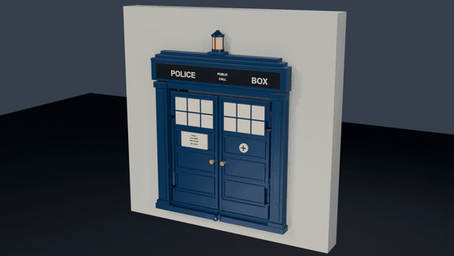

# TARDIS Geronimeow — a 3D-printable TARDIS cat door

**[Version française](README.fr.md)**


**[Download](#download)** · **[Quick start](#quick-start)** · **[Full guide](tardis_v8/README.en.md)** ·
**[Shopping list](docs/en/PRINTING_AND_ASSEMBLY.md#shopping-list)** · **[FAQ](#faq)**

A cat door (cat flap) that looks like a police box, with a TARDIS front **on both sides of the
door**. It is designed for a multicolour printer (developed on a Creality K1 Max with
CFS) and ships as ready-to-slice Creality Print projects.

> [!WARNING]
> **Untested prototype.** Every plate slices cleanly in Creality Print 7.3.1 and the
> mechanism is checked numerically (collisions, swing, lock). **No part has been printed
> yet.** Start with the 20-minute test coupon and the 1:1 mechanical prototype, and tell
> us how it went in a [print report](../../issues/new/choose).

## Features

- **Two double-swing flaps** that come back to centre **by gravity**, with no spring:
  a V-shaped cam lifts each flap as it opens.
- **Adjustable return force**: three interchangeable cams (3.5, 4.5 and 5.5 mm rise),
  swapped in seconds.
- **One-button central lock**: a printed blade locks both flaps (FREE / LOCKED).
- **Wind-proof magnets**, with the holding force set by 1 mm printed shims.
- **Optional smart lighting**: two RGB lanterns and a passage sensor (reed switches)
  driven by an ESP32 hidden under the tunnel. ESPHome config included (Home Assistant),
  WLED also works.
- **Printed door template** for cutting and drilling the door.
- Four colours: TARDIS blue, ivory, black and brass.



[Full assembly video (MP4, 78 s)](tardis_v8/visualisations/montage_complet_V8_en.mp4) ·
[closed view](tardis_v8/01_vue_fermee.png) · [open view](tardis_v8/02_vue_ouverte.png) ·
[rear view](tardis_v8/03_vue_arriere_fermee.png)

## Key dimensions

| | |
|---|---|
| Opening (tunnel) | 190 × 200 mm |
| Each front | 244 × 314.5 mm (with lantern) |
| Door thickness | 40 mm by default (change `door_depth` and regenerate) |
| Door cut-out | 196.2 × 206.2 mm + a 36 × 11 mm notch, using the printed template |
| Print volume | 12 plates, each fitting 300 × 295 mm |

## What you need

- A printer able to do **4 colours** (or swap filament by hand) with a bed of at least
  **285 × 252 mm** for the fronts. The 3MF projects target a **Creality K1 Max** with
  **Creality Print 7.3.1**; STL files are provided for other slicers.
- About **880 g of PLA** (mostly blue) and a little TPU for the soft stops.
- Hardware: 3 mm steel rods, clips, Ø6 mm magnets, M3 and M4 screws. See the
  [shopping list](docs/en/PRINTING_AND_ASSEMBLY.md#shopping-list).
- Optional electronics: ESP32-C3 SuperMini, two WS2812B 5 mm LEDs, two reed switches.

## Download

- **Ready-to-slice plates** (Creality Print 3MF projects) and **all parts as STL**:
  grab the zip files from the [latest release](../../releases/latest), or browse
  [`tardis_v8/3mf/`](tardis_v8/3mf/) and [`tardis_v8/stl/`](tardis_v8/stl/).
- **ESPHome configuration**: [`tardis_v8/esphome/`](tardis_v8/esphome/).

## Quick start

1. Measure your door. The files assume **40 mm**; the M4 screws depend on it.
2. Print `00_Eprouvette_jeux` (test coupon) and `01_Prototype_mecanique_75mm`. Check
   the fits, pick the cam that gives the return force you like and set the magnets.
3. Print the remaining plates from [`tardis_v8/3mf/`](tardis_v8/3mf/), following the
   [step-by-step Creality Print guide](docs/en/CREALITY_PRINT_GUIDE.md).
4. Cut the door with the template, then assemble.
   [Printing and assembly guide](docs/en/PRINTING_AND_ASSEMBLY.md).
5. Run at least **50 open/close cycles by hand**, in both modes, before leaving your
   cat alone with it.

## FAQ

**Do I need a Creality printer?** No. The 3MF projects are tuned for a Creality K1 Max
with CFS and Creality Print, and should also open in OrcaSlicer and Bambu Studio (same
3MF family, untested). With any other slicer, use the STL files and the orientation tips
of the [printing guide](docs/en/PRINTING_AND_ASSEMBLY.md#before-printing).

**I only have a single-colour printer.** It works: print everything in blue and paint
the windows, sign and knobs (the colours are inlaid side by side on the same layers, so
pausing to swap filament is not enough). The mechanism does not depend on colour.

**My door is not 40 mm thick.** Change `door_depth` at the top of
`tardis_v8/generate.py` and regenerate (the tunnel follows), see
[Development](docs/en/DEVELOPMENT.md). Remember to buy M4 screws of the right length.

**Is it big enough for my cat?** The opening is 190 × 200 mm, larger than most
standard cat flaps. For a very large cat (Maine Coon), the opening size is a parameter,
but mouldings, holes and clearances then need checking.

**Do I need the electronics?** No. The lighting and the passage sensor are optional;
without them the cradle and the grooves simply stay empty.

**Does it read microchips?** No. It is not a selective cat flap: in LOCKED mode no one
gets in or out, in FREE mode everyone does.

**Will PLA survive outdoors?** PLA softens around 55 °C. On a door facing full sun,
print at least the outdoor front in PETG or ASA (and check the fits with the test
coupon in that material). Not tested yet.

**Can I sell prints?** No. The models are licensed for non-commercial use only, and
TARDIS is a BBC trademark.

## Documentation

| | English | Français |
|---|---|---|
| Printing, shopping list, assembly | [Printing and assembly](docs/en/PRINTING_AND_ASSEMBLY.md) | [Impression et montage](docs/IMPRESSION_ET_MONTAGE.md) |
| Step-by-step Creality Print guide | [Creality Print guide](docs/en/CREALITY_PRINT_GUIDE.md) | [Guide Creality Print](docs/GUIDE_CREALITY_PRINT.md) |
| Full V8 guide (cams, lock, wiring, ESPHome) | [V8 guide](tardis_v8/README.en.md) | [Guide V8](tardis_v8/README.md) |
| Design choices and limits | [Design](docs/en/DESIGN.md) | [Conception](docs/CONCEPTION.md) |
| Checks and what remains to validate | [Validation](tardis_v8/README.en.md#validation) | [Validation](docs/VALIDATION.md) |
| Regenerating the model | [Development](docs/en/DEVELOPMENT.md) | [Développement](docs/DEVELOPPEMENT.md) |
| Design history | — | [Historique](docs/HISTORIQUE.md) |

## Repository layout

```
tardis_v8/
  3mf/            12 ready-to-slice Creality Print projects
  stl/            every part as STL
  esphome/        ESPHome configuration (lights, sensor, counter)
  generate.py     parametric model (Blender 5)
  images/         figures used by the guides
  visualisations/ assembly video and GIF
docs/             guides in French, English versions in docs/en/
scripts/          slicing checks, figures, Creality project export
```

The whole model is generated by code: change a parameter in `tardis_v8/generate.py`
(door thickness, opening size, clearances) and rebuild everything, see
[Development](docs/en/DEVELOPMENT.md).

## Contributing

Print reports, photos, fit measurements and fixes are very welcome. See
[CONTRIBUTING.md](CONTRIBUTING.md) and the [code of conduct](CODE_OF_CONDUCT.md).

## Safety

This is a door your pet will use unsupervised. Check that the flaps cannot trap a paw
or tail, that the lock cannot engage by itself, and test it thoroughly before use. The
electronics run on 5 V USB only. You build and use it at your own risk.

## License and credits

- Models, images and documentation: **CC BY-NC-SA 4.0**. Code: **MIT**. See
  [LICENSE.md](LICENSE.md).
- Inspired by the [TARDIS Deluxe Kit](https://www.thingiverse.com/thing:124033) by
  countspatula (CC BY-NC-SA 3.0). No file from it is reused, see
  [provenance](docs/PROVENANCE.md).
- TARDIS, DOCTOR WHO and POLICE BOX are trademarks of the BBC. This is a
  non-commercial fan project, not affiliated with or endorsed by the BBC.
