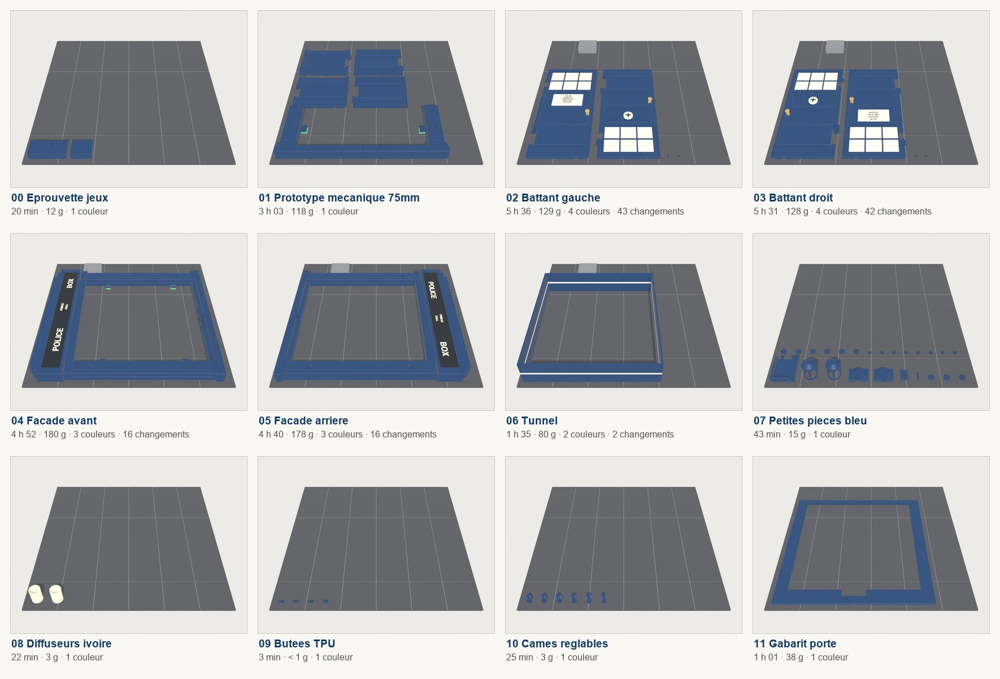
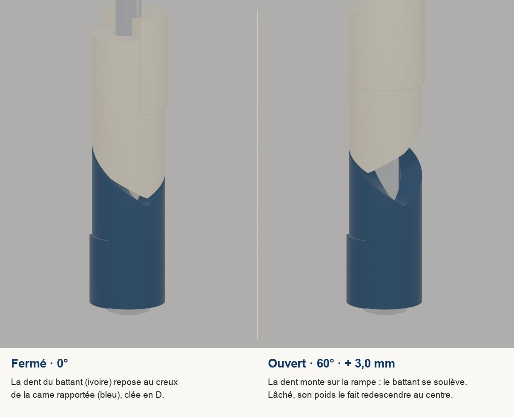
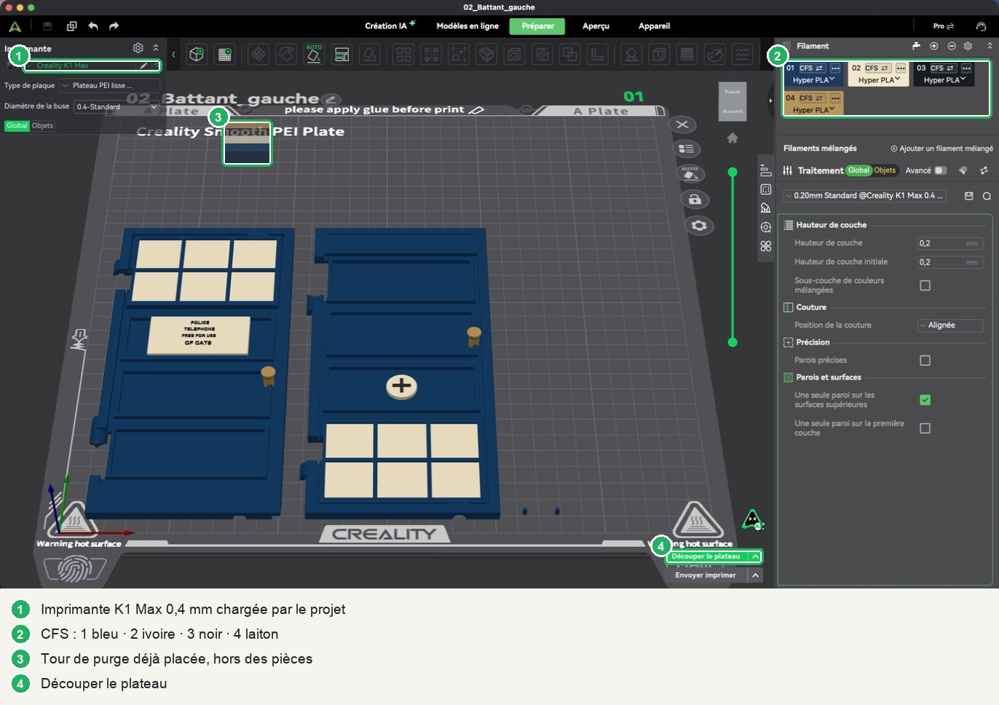
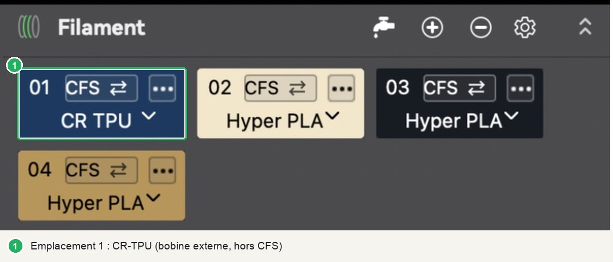
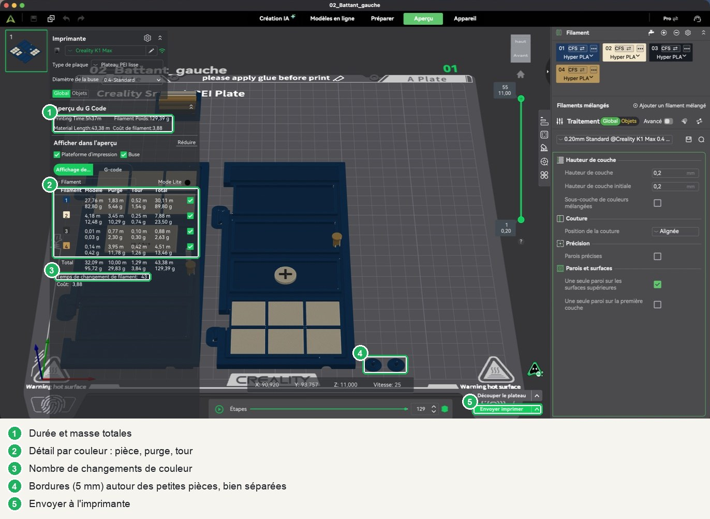
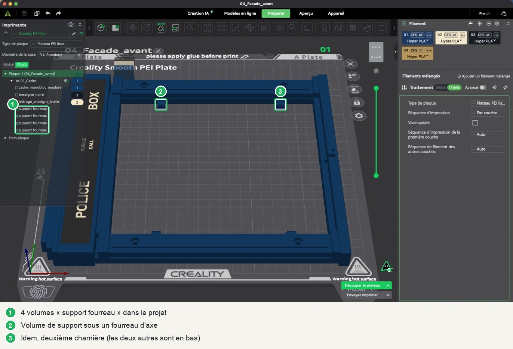
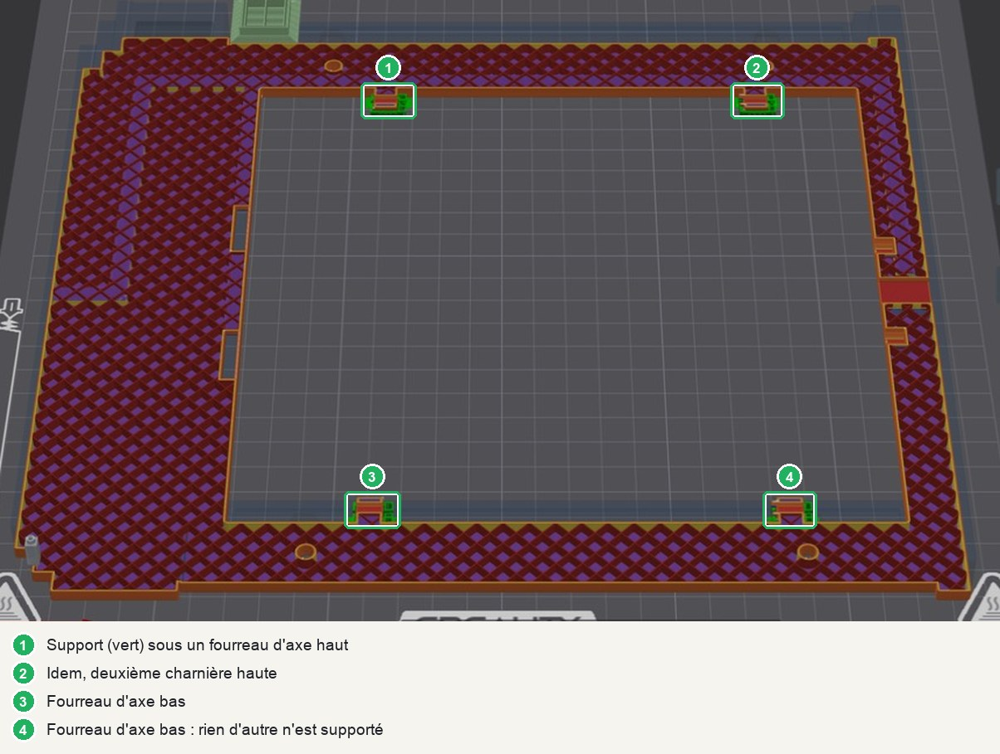

# Imprimer la chatière avec Creality Print — pas à pas

**[English version](en/CREALITY_PRINT_GUIDE.md)**

Ce guide part d'un plateau du dépôt et va jusqu'à l'envoi à la K1 Max. Il concerne la
[V8](../tardis_v8/README.md), la version unique de la chatière : 12 plateaux, rappel
**par gravité, sans ressort**, cames réglables, verrou central, aimants anti-vent,
capteur de passage et éclairage RGB. Captures faites dans Creality Print 7.3.1 sur macOS.

> **En bref.** Chaque fichier de `tardis_v8/3mf/` est un projet Creality Print complet :
> imprimante, profil, couleurs, tour de purge, supports et réglages particuliers sont
> déjà prêts. Ouvrir, vérifier les bobines, cliquer sur **Découper le plateau**,
> imprimer. Les 12 plateaux ont été ouverts et tranchés un par un : aucun avertissement.

## Où en est-on ?

| Prêt à imprimer — vérifié | Pas encore éprouvé — à valider par vous |
|---|---|
| Les 12 plateaux s'ouvrent et se tranchent dans Creality Print 7.3.1 sans avertissement | Aucune pièce n'a encore été imprimée |
| Chaque couleur va sur le bon emplacement du CFS | Jeux réels sur votre machine : axes, lame du verrou, aimants, demi-coques |
| Tour de purge hors des pièces, aucune pièce en l'air | Rendu des petits détails : lettres, vitres, ponts des lanternes |
| Supports uniquement sous les fourreaux d'axe du cadre | Retrait propre de ces supports |
| Cames en couches de 0,1 mm, pleines (réglage par objet) | Glissement réel de la came, choix de la pente |
| Maillages fermés, 3MF valides, assemblage sans collision en simulation | Force des aimants, seuil des ILS |
| Débattement de ±80° avec chacune des trois cames, verrou central contrôlé numériquement | Collage, tenue des butées TPU, sécurité du chat (50 cycles à la main) |

Autrement dit : les fichiers sont prêts, la chatière reste un prototype. Commencer
par l'éprouvette et le prototype 75 mm (voir [Valider avant de tout
imprimer](#valider-avant-de-tout-imprimer)).



*Les 12 plateaux de la V8 sur le plateau K1 Max (300 × 300 mm). Gris foncé :
tour de purge. Vert : volumes de support. Temps et masses mesurés par Creality Print.*

### Le rappel par gravité en une image



Sous chaque battant, une came en V : en s'ouvrant, le battant monte (3 mm à 60° avec
la came de 4,5 mm) ; lâché, son poids le ramène au centre, dans les deux sens. La
came est rapportée : trois pentes sont fournies pour régler la force de rappel.

## Avant de commencer

| Il faut | Détail |
|---|---|
| Imprimante | Creality K1 Max, buse 0,4 mm, avec CFS |
| Logiciel | Creality Print 7.3.1 (testé) |
| Bobines CFS | 1 bleu TARDIS · 2 ivoire · 3 noir · 4 laiton (PLA ; profils Hyper PLA dans les projets) |
| Bobine externe | TPU, uniquement pour les butées |
| Plateau | PEI lisse, avec une fine couche de colle comme indiqué par Creality |

**Ordre conseillé :** `00_Eprouvette_jeux`, `01_Prototype_mecanique_75mm`,
`10_Cames_reglables` et `07_Petites_pieces_bleu` (lame du verrou, cales), puis
`11_Gabarit_porte` pour découper la porte. Lancer les grandes pièces une fois le
rappel, les aimants et le verrou validés.

## Étape 1 — Ouvrir le plateau

Double-cliquer sur le `.3mf` ou utiliser **Fichier → Ouvrir un projet**. Le projet
charge tout seul l'imprimante, le profil 0,20 mm Standard et les quatre couleurs.
Aucune boîte « fichier d'un autre logiciel » ne doit apparaître.



Si la tour de purge (le petit bloc gris en haut à gauche) n'est pas au-dessus des
pièces, ne pas la déplacer vers le bas : rouvrir le fichier d'origine.

## Étape 2 — Vérifier les bobines

Dans le panneau **Filament**, synchroniser le CFS ou réaffecter les emplacements
pour que les couleurs correspondent : **1 bleu, 2 ivoire, 3 noir, 4 laiton**. Les
couleurs de l'écran sont celles du projet ; c'est l'emplacement qui compte.

Pour les butées (`09_Butees_TPU`), l'emplacement 1 est en **CR-TPU** : le CFS ne gère
pas le TPU, charger la bobine externe.



## Étape 3 — Découper et contrôler l'aperçu

Cliquer sur **Découper le plateau**. L'onglet **Aperçu** affiche la durée, la masse
et le détail par couleur. Aucun bandeau jaune ou rouge ne doit apparaître en bas
à gauche.



Repères pour contrôler (préréglages des projets, purge × 1,3) :

| Plateau | Durée | Masse | Couleurs | Changements |
|---|---:|---:|---:|---:|
| `02_Battant_gauche` | 5 h 37 | 129 g | 4 | 43 |
| `04_Facade_avant` | 4 h 52 | 180 g | 3 | 16 |
| `06_Tunnel` | 1 h 35 | 80 g | 2 | 2 |
| `10_Cames_reglables` | 26 min | 3 g | 1 | 0 |

Les mêmes valeurs s'affichent dans l'interface et en ligne de commande (par exemple
5 h 37 et 129,39 g pour le battant gauche, capture ci-dessus). Les cames comptent
141 couches : la hauteur de 0,1 mm est bien appliquée.

Tous les plateaux sont dans
[controle_tranchage.json](../tardis_v8/controle_tranchage.json).

## Étape 4 — Les supports, seulement où il faut

Une seule pièce en a besoin : le **cadre avant** (et son prototype bas). Couché à
plat, le dessous arrondi des fourreaux d'axe de charnière se trouve à 0,8 mm du
plateau. Le projet contient quatre petits volumes **« support fourreau »** qui
limitent les supports à cette zone. Le reste du cadre n'en reçoit aucun : canal du
verrou, logements d'aimant, rainures de câbles, trous de vis et trous d'axe restent
libres.





Après impression, retirer ces supports à la pince fine. Si l'axe force dans le
fourreau, reprendre le trou au foret Ø3,4 mm tenu à la main.

Ne pas activer les supports automatiques sur les autres plateaux : les seuls
surplombs restants sont des ponts courts (rainures de câbles de 4,5 mm, trous d'axe,
anneau haut des lanternes), qui s'impriment très bien sans support.

**Bordures.** Les petites pièces et celles plus hautes que larges (pions, cames, cales,
lame et tourniquet du verrou, diffuseurs, cages) ont déjà une bordure de 5 mm dans le
projet : elles ne se décrochent pas. Elle se retire à la main après impression.

## Étape 5 — Imprimer

**Envoyer imprimer** vers la K1 Max, ou **Fichier → Exporter** pour un G-code sur clé USB. Laisser
refroidir le plateau avant de décoller les grandes pièces (façades, tunnel, gabarit).

## Valider avant de tout imprimer

### 1. L'éprouvette (`00_Eprouvette_jeux`, 20 min)

Elle reproduit chaque ajustement de la chatière. Essayer avec les vraies
fournitures :

| Essai sur l'éprouvette | Attendu |
|---|---|
| Axe Ø3 mm dans le trou de pivot (Ø3,4) | Tourne librement, sans jeu qui fasse pencher l'axe |
| Vis M4 dans le trou de fixation (Ø4,6) | Passe à la main |
| Lamage Ø8,6 mm | Reçoit la tête de vis, puis le cache sans forcer |
| Pion Ø2 mm dans le petit trou borgne (Ø2,2) | S'enfonce au doigt et tient |
| Aimant Ø6 × 2 dans son logement (Ø6,3) | Entre à la main, sans jeu |
| Vis M3 dans l'avant-trou (Ø2,5) | Se visse et tient, sans fendre |
| ILS dans sa poche | Se couche sans forcer sur l'ampoule de verre |
| Lame du verrou (plateau 07) dans le canal | Coulisse et retombe seule par son poids |
| Came (plateau 10) sur la clé en D | S'emboîte d'un seul sens, sans tourner |

### 2. Le prototype 1:1 (`01_Prototype_mecanique_75mm`, environ 3 h)

Le bas du cadre et le bas des deux battants, en vraie grandeur, avec le seuil, le
verrou et les logements d'aimant. Poser les cames de 4,5 mm, les axes et leurs clips,
puis vérifier :

- chaque battant monte en s'ouvrant et **revient seul au centre**, dans les deux sens,
  lâché à 30° comme à 80°. S'il s'arrête avant, passer aux cames de 5,5 mm ; s'il est
  dur à ouvrir, passer à 3,5 mm ;
- avec les aimants (une cale pour commencer), le battant reste fermé au souffle et
  s'ouvre d'un doigt. Ajuster le nombre de cales, puis coller ;
- verrou en FERMÉ : aucun battant ne bouge ; en LIBRE : rien ne dépasse du seuil ;
- les deux demi-coques s'alignent avec les pions avant collage ;
- les supports sous les fourreaux se retirent proprement.

### 3. Si un ajustement ne va pas

Noter l'essai concerné et ce qui se passe (« l'axe force », « la lame frotte »…), avec
si possible le diamètre mesuré au pied à coulisse. Les jeux sont des paramètres du
générateur (`fit_clearance`, `pivot_hole`, `lock_width`, `magnet_d`, `cam_rises`…) :
on les corrige, on régénère, et tous les plateaux suivent. Ne pas percer ni limer les
grandes pièces pour compenser.

### 4. Après le montage complet

Ordre de montage en vidéo : [V8](../tardis_v8/visualisations/montage_complet_V8.mp4).

Faire au moins **50 cycles à la main** dans chaque mode avant de laisser le chat
seul. En FERMÉ, vérifier qu'une poussée franche ne libère aucun battant.

## En cas de souci

| Symptôme | Cause probable | Que faire |
|---|---|---|
| « Ce fichier de projet n'est pas de Creality Print » | Fichier régénéré sans l'étape d'export | `python3 scripts/exporter_projets_creality.py tardis_v8` |
| Le battant ne revient pas au centre | Pente trop faible ou came rugueuse | Cames de 5,5 mm ; graphite sec sur la rampe |
| Le battant reste ouvert au vent | Aimants trop loin | Ajouter une cale sous l'aimant du seuil |
| Le chat peine à pousser | Aimants trop proches ou came trop raide | Retirer une cale ; cames de 3,5 mm |
| Le compteur ne voit pas les passages | ILS trop loin de l'aimant ou mal orienté | Rapprocher l'ampoule dans sa poche, extrémité au-dessus de l'aimant |
| Conflit « WipeTower ↔ … » | Tour déplacée à la main | Rouvrir le fichier, ne pas toucher à la tour |
| « Régions flottantes » | Supports désactivés sur le cadre | Rouvrir le fichier ; ne pas modifier les volumes « support fourreau » |
| « Multiplicateur de flush trop bas » | Projet modifié ou ancien | Remettre la purge à 1,3 ou rouvrir le fichier |
| Mauvaise couleur imprimée | Bobine dans le mauvais emplacement du CFS | Reprendre l'étape 2 |

## Refaire les fichiers et les images

```sh
/Applications/Blender.app/Contents/MacOS/Blender --background --python tardis_v8/generate.py -- --no-render
.venv/bin/python tardis_v8/verify_3mf.py
python3 scripts/exporter_projets_creality.py tardis_v8
python3 scripts/trancher_creality_print.py tardis_v8
/Applications/Blender.app/Contents/MacOS/Blender --background --python scripts/vignettes_plateaux.py -- tardis_v8
.venv/bin/python scripts/planche_plateaux.py tardis_v8
```

Les captures d'écran de ce guide sont faites à la main dans Creality Print 7.3.1, puis
annotées en français et en anglais par `scripts/annoter_captures.py` (captures brutes
dans `docs/images/creality/brut/`). Une version plus récente de Creality Print devrait
ouvrir les projets de la même façon, mais seule la 7.3.1 a été testée.
