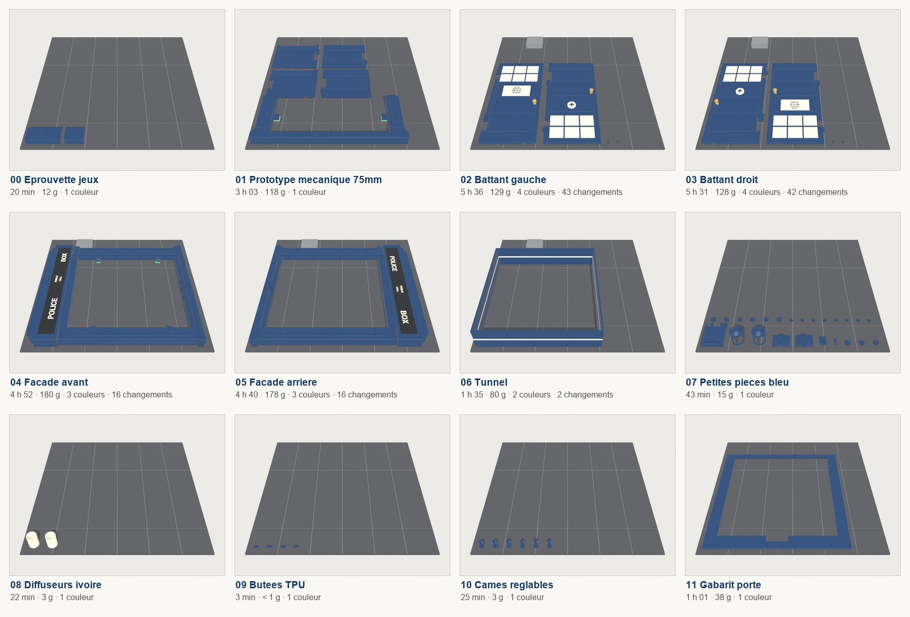
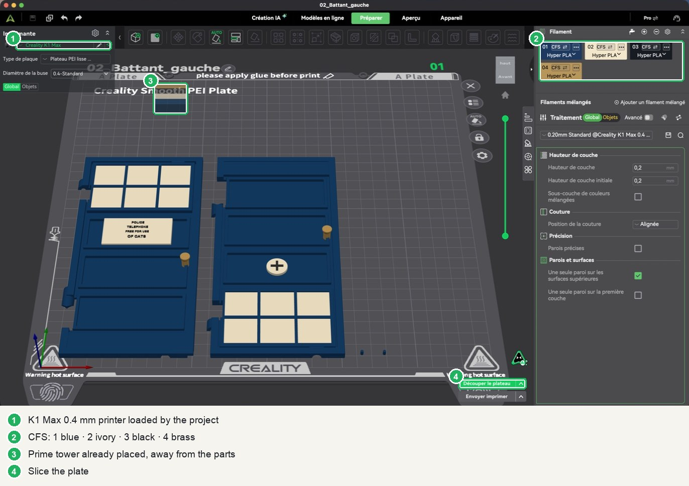
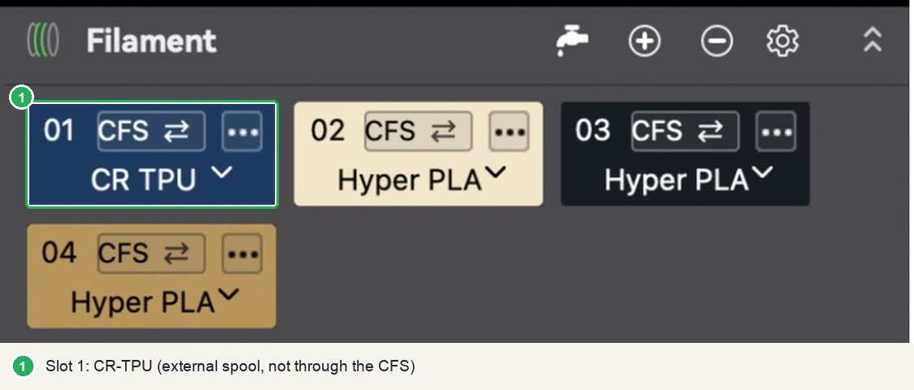
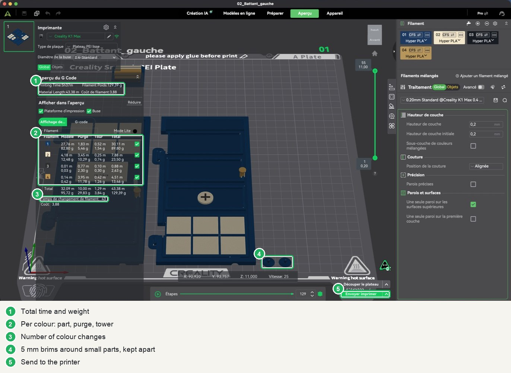
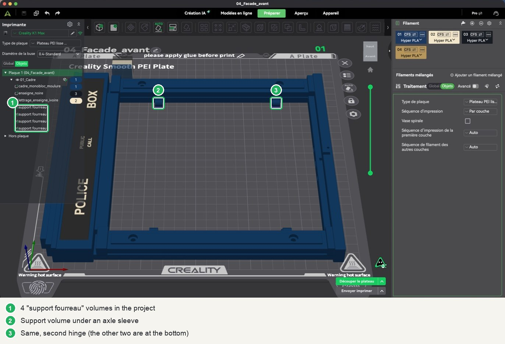
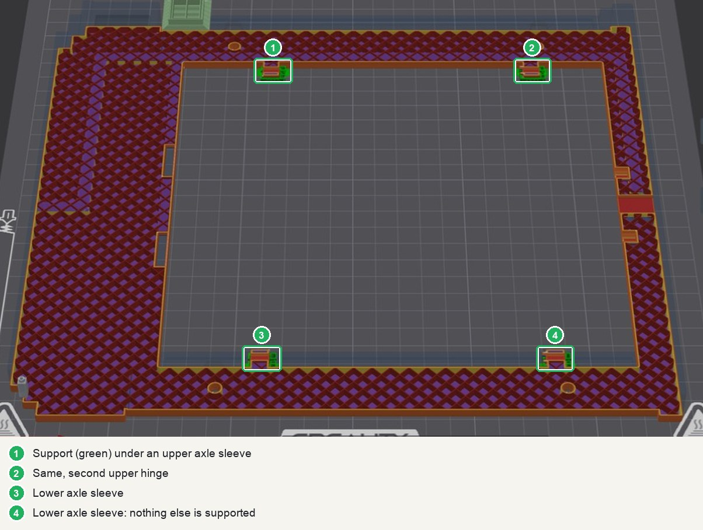

# Printing the cat door with Creality Print — step by step

**[Version française](../GUIDE_CREALITY_PRINT.md)**

This guide takes you from a plate in the repository to a print on the K1 Max. It
covers [V8](../../tardis_v8/README.en.md), the current version of the cat door: 12
plates, **gravity return without springs**, adjustable cams, central lock, wind-proof
magnets, passage sensor and RGB lighting. Screenshots were taken in Creality Print
7.3.1 on macOS (interface in French; the numbered captions are in English).

> **In short.** Every file in `tardis_v8/3mf/` is a complete Creality Print project:
> printer, profile, colours, prime tower, supports and per-object settings are ready.
> Open it, check the spools, click **Slice plate** (« Découper le plateau »), print.
> All 12 plates have been opened and sliced one by one: no warning.

## Where do things stand?

| Ready to print — checked | Not proven yet — for you to validate |
|---|---|
| All 12 plates open and slice in Creality Print 7.3.1 without warning | No part has been printed yet |
| Each colour goes to the right CFS slot | Real clearances on your machine: axles, lock blade, magnets, half-shells |
| Prime tower away from the parts, no floating part | Rendering of small details: letters, windows, lantern bridges |
| Supports only under the frame's axle sleeves | Clean removal of those supports |
| Cams in 0.1 mm layers, 100 % infill (per-object setting) | Real cam sliding, choice of slope |
| Closed meshes, valid 3MF files, collision-free assembly in simulation | Magnet strength, reed switch threshold |
| ±80° swing with each of the three cams, central lock checked numerically | Gluing, TPU stop durability, cat safety (50 cycles by hand) |

In other words: the files are ready, the cat door is still a prototype. Start with the
test coupon and the 75 mm prototype (see [Validate before printing
everything](#validate-before-printing-everything)).



*The 12 V8 plates on the K1 Max bed (300 × 300 mm). Dark grey: prime tower. Green:
support volumes. Times and weights measured by Creality Print.*

## Before you start

| You need | Details |
|---|---|
| Printer | Creality K1 Max, 0.4 mm nozzle, with CFS |
| Software | Creality Print 7.3.1 (tested) |
| CFS spools | 1 TARDIS blue · 2 ivory · 3 black · 4 brass (PLA; Hyper PLA profiles in the projects) |
| External spool | TPU, only for the soft stops |
| Build plate | Smooth PEI, with a thin layer of glue as recommended by Creality |

**Suggested order:** `00_Eprouvette_jeux`, `01_Prototype_mecanique_75mm`,
`10_Cames_reglables` and `07_Petites_pieces_bleu` (lock blade, shims), then
`11_Gabarit_porte` to cut the door. Start the large parts once the return force,
magnets and lock are validated.

## Step 1 — Open the plate

Double-click the `.3mf` file or use **File → Open project**. The project loads the
printer, the 0.20 mm Standard profile and the four colours by itself. No "file from
another application" dialog should appear.



If the prime tower (the small grey block at the top left) is not above the parts, do
not drag it down: reopen the original file.

## Step 2 — Check the spools

In the **Filament** panel, sync the CFS or reassign the slots so the colours match:
**1 blue, 2 ivory, 3 black, 4 brass**. The colours on screen are the project's; what
matters is the slot.

For the stops (`09_Butees_TPU`), slot 1 is set to **CR-TPU**: the CFS cannot feed TPU,
load the external spool.



## Step 3 — Slice and check the preview

Click **Slice plate**. The **Preview** tab shows time, weight and the per-colour
breakdown. No yellow or red banner should appear at the bottom left.



Reference values (project presets, purge × 1.3):

| Plate | Time | Weight | Colours | Changes |
|---|---:|---:|---:|---:|
| `02_Battant_gauche` | 5 h 37 | 129 g | 4 | 43 |
| `04_Facade_avant` | 4 h 52 | 180 g | 3 | 16 |
| `06_Tunnel` | 1 h 35 | 80 g | 2 | 2 |
| `10_Cames_reglables` | 26 min | 3 g | 1 | 0 |

The GUI and the command line show the same values (for example 5 h 37 and 129.39 g for
the left flap, screenshot above). The cams have 141 layers: the 0.1 mm layer height is
applied.

All plates are listed in
[controle_tranchage.json](../../tardis_v8/controle_tranchage.json).

## Step 4 — Supports, only where needed

Only one part needs them: the **front frame** (and its bottom prototype). Lying flat,
the rounded underside of the hinge axle sleeves is 0.8 mm above the bed. The project
contains four small **"support fourreau"** volumes that restrict supports to that
area. The rest of the frame gets none: lock channel, magnet pockets, cable grooves,
screw holes and axle holes stay clear.





After printing, remove these supports with fine pliers. If the axle is tight in the
sleeve, ream the hole with a Ø3.4 mm drill bit held by hand.

Do not enable automatic supports on the other plates: the only remaining overhangs are
short bridges (4.5 mm cable grooves, axle holes, upper ring of the lanterns), which
print fine without support.

**Brims.** Small parts and parts taller than they are wide (pins, cams, shims, lock
blade and latch, diffusers, cages) already have a 5 mm brim in the project so they stay
on the bed. Peel it off by hand after printing.

## Step 5 — Print

**Send to print** to the K1 Max, or **File → Export** a G-code to a USB stick. Let the
bed cool down before removing the large parts (fronts, tunnel, template).

## Validate before printing everything

### 1. The test coupon (`00_Eprouvette_jeux`, 20 min)

It reproduces every fit of the cat door. Try it with the real hardware:

| Test on the coupon | Expected |
|---|---|
| Ø3 mm axle in the pivot hole (Ø3.4) | Turns freely, without enough play to tilt |
| M4 screw in the fixing hole (Ø4.6) | Goes through by hand |
| Ø8.6 mm counterbore | Takes the screw head, then the cap without force |
| Ø2 mm pin in the small blind hole (Ø2.2) | Pushes in by finger and holds |
| Ø6 × 2 magnet in its pocket (Ø6.3) | Goes in by hand, without play |
| M3 screw in the pilot hole (Ø2.5) | Screws in and holds, without splitting |
| Reed switch in its pocket | Lies down without forcing the glass |
| Lock blade (plate 07) in the channel | Slides and drops by its own weight |
| Cam (plate 10) on the D-key | Fits one way only, without turning |

### 2. The 1:1 prototype (`01_Prototype_mecanique_75mm`, about 3 h)

The bottom of the frame and of both flaps at full size, with the sill, the lock and the
magnet pockets. Fit the 4.5 mm cams, the axles and their clips, then check:

- each flap rises as it opens and **comes back to centre by itself**, in both
  directions, released at 30° as well as at 80°. If it stops short, use the 5.5 mm
  cams; if it is hard to open, use 3.5 mm;
- with the magnets (one shim to start with), the flap stays closed when you blow on it
  and opens with one finger. Adjust the number of shims, then glue;
- lock LOCKED: no flap moves; FREE: nothing sticks out of the sill;
- the two half-shells line up with the pins before gluing;
- the supports under the sleeves come off cleanly.

### 3. If a fit is wrong

Note which test and what happens ("the axle is tight", "the blade rubs"…), ideally with
the diameter measured with calipers. Clearances are generator parameters
(`fit_clearance`, `pivot_hole`, `lock_width`, `magnet_d`, `cam_rises`…): fix them,
regenerate, and every plate follows. Do not drill or file the large parts to compensate.
Please share your findings in a [print report](../../../../issues/new/choose).

### 4. After full assembly

Assembly order on video:
[V8, English captions](../../tardis_v8/visualisations/montage_complet_V8_en.mp4).

Run at least **50 cycles by hand** in each mode before leaving the cat alone. In
LOCKED mode, check that a firm push does not free either flap.

## Troubleshooting

| Symptom | Likely cause | What to do |
|---|---|---|
| "This project file is not from Creality Print" | File regenerated without the export step | `python3 scripts/exporter_projets_creality.py tardis_v8` |
| The flap does not come back to centre | Slope too gentle or rough cam | 5.5 mm cams; dry graphite on the ramp |
| The flap stays open in the wind | Magnets too far apart | Add a shim under the sill magnet |
| The cat struggles to push | Magnets too close or cam too steep | Remove a shim; 3.5 mm cams |
| The counter misses passages | Reed switch too far from the magnet or badly oriented | Move the glass closer in its pocket, end above the magnet |
| "WipeTower ↔ …" conflict | Tower moved by hand | Reopen the file, do not touch the tower |
| "Floating regions" | Supports disabled on the frame | Reopen the file; do not edit the "support fourreau" volumes |
| "Flush multiplier too low" | Modified or old project | Set purge back to 1.3 or reopen the file |
| Wrong colour printed | Spool in the wrong CFS slot | Go back to step 2 |

## Rebuilding the files and images

```sh
/Applications/Blender.app/Contents/MacOS/Blender --background --python tardis_v8/generate.py -- --no-render
.venv/bin/python tardis_v8/verify_3mf.py
python3 scripts/exporter_projets_creality.py tardis_v8
python3 scripts/trancher_creality_print.py tardis_v8
/Applications/Blender.app/Contents/MacOS/Blender --background --python scripts/vignettes_plateaux.py -- tardis_v8
.venv/bin/python scripts/planche_plateaux.py tardis_v8
```

Screenshots are taken by hand in Creality Print 7.3.1, then annotated in French and
English by `scripts/annoter_captures.py` (raw captures in `docs/images/creality/brut/`).
A newer Creality Print should open the projects the same way, but only 7.3.1 has been
tested.
