# TARDIS Geronimeow V8 — full guide

**[Version française](README.md)** · [Project home](../README.md)

V8 is the current version of the cat door:

- the flaps come back to centre **by gravity**, with no spring;
- the **cams are separate and interchangeable**, so you can tune the return force
  without reprinting anything else;
- a **single central lock** blocks both flaps with one knob;
- **wind-proof magnets** keep the flaps closed, with shim adjustment;
- a **passage sensor** (reed switches) and the **RGB lanterns** are driven by an ESP32
  hidden under the tunnel;
- a **printed template** is used to cut the door.

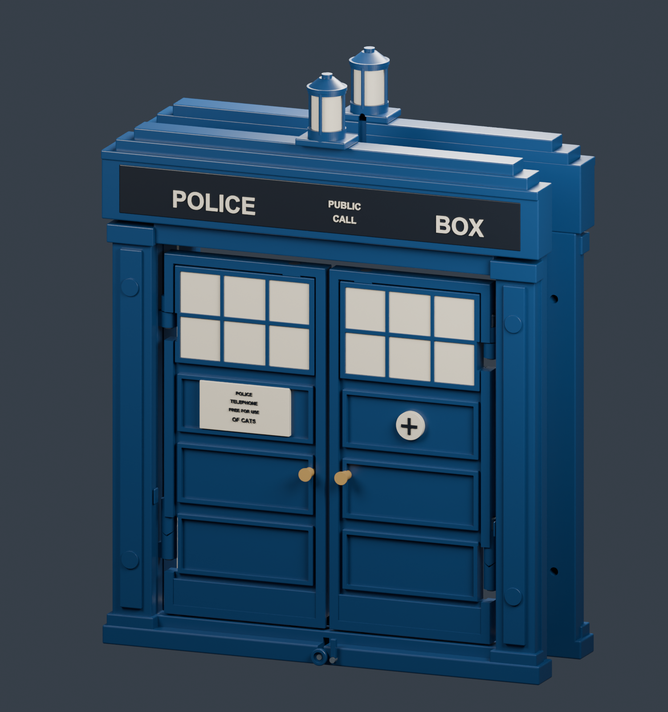

> **Status:** the 12 plates are ready to print and Creality Print 7.3.1 slices them
> without any warning, both from the command line and in the GUI. Nothing has been
> printed yet: the return force, magnets and sensor are tuned on the 75 mm prototype
> (see [Validate and tune](#validate-and-tune)).
>
> The figures in this guide are labelled in French; the captions below explain them.

| Mode | In | Out | How |
|---|---:|---:|---|
| FREE (LIBRE) | yes | yes | lock knob down, the blade sits below the sill |
| LOCKED (FERMÉ) | no | no | knob up, turn latch rotated under it: the blade blocks both flaps |

## Gravity return and adjustable cams

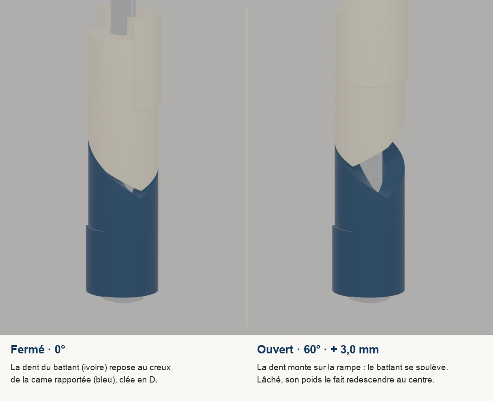

Under each flap, a **V-shaped cam** sitting on the frame knuckle lifts the flap as it
opens: 3 mm at 60° with the 4.5 mm cam. Released, the flap slides back down into the
bottom of the V under its own weight, which is the closed position, in both
directions.

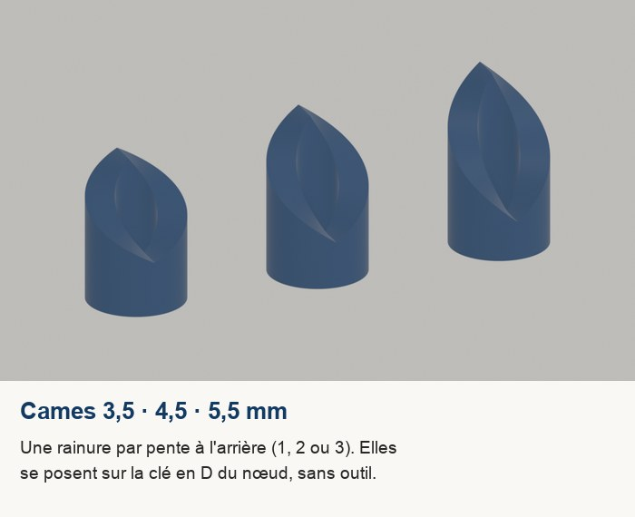

**Tuning.** The cam is a small part slid onto the axle, with a D-key underneath: it
cannot rotate or go in upside down, and the same cam fits left and right. Three slopes
are supplied, marked by 1, 2 or 3 grooves at the back:

| Cam | Grooves | Lift at 60° | Lift at the stop (85°) | Estimated return torque | Feel |
|---|:---:|---:|---:|---:|---|
| 3.5 mm | 1 | 2.3 mm | 3.3 mm | about 2.2 mN·m | softer |
| **4.5 mm** (fitted by default) | 2 | 3.0 mm | 4.25 mm | about 2.8 mN·m | balanced |
| 5.5 mm | 3 | 3.7 mm | 5.2 mm | about 3.4 mN·m | firmer return |

**Why the same flap works with all three cams.** The underside of the flap knuckle is
not a copy of one cam. It is the envelope of all three: gentle slope up to 60° on
either side of the bottom of the V, steep slope beyond. Whatever cam is fitted, the
flap rests on it along the two lines at ±60°, at the same height. It therefore always
sits at the same level at rest and rises according to the chosen slope. `generate.py`
checks this for every cam and every angle (minimum clearance 0.3 mm, see
`cam_envelope` in `verification.json`).

The cams print upright with **0.1 mm layers** and 100 % infill (per-object settings
already in the project) for a smooth ramp. A little dry graphite on the ramp reduces
friction; avoid grease, which collects dust.

## Central lock

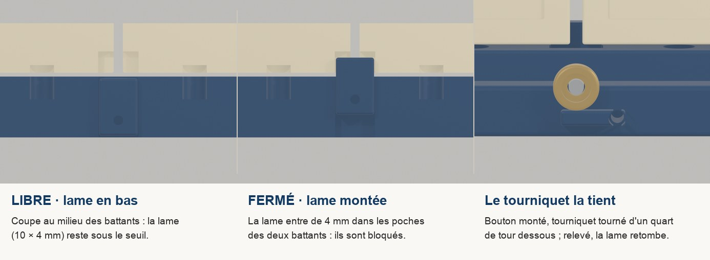

A **printed 10 × 4 mm blade** slides vertically in the middle of the sill. A knob,
screwed to it with an M3 × 18, sticks out through a vertical slot at the bottom of
the front. Next to it, a **turn latch** (a small printed catch pivoting on an M3 × 12
screw, like on a cabinet) holds the knob up:

- **LOCKED**: lift the knob, turn the latch a quarter turn towards the centre, let
  go: the knob rests on it. The blade enters 4 mm into a pocket at the bottom corner of
  each flap, closed front and back: both flaps are blocked in both directions (numerical
  check: blocked from 0.5°).
- **FREE**: lift the knob slightly, turn the latch up, let go. The blade drops under its
  own weight below the sill, 0.5 mm under the surface: nothing sticks out for the cat.

The blade is guided within 0.2 mm and only moves vertically. The front face of the
channel, printed as a 10.4 mm bridge (front lying on its back on the bed), has an extra
0.2 mm of clearance so that a slightly sagging bridge cannot jam it. The turn latch,
not a notch in the slot, holds it up: a side notch would need the blade to shift
sideways, which its guide prevents.

There are no steel bolts or collars. The blade channel is open at the bottom, so dust
falls through and blocks nothing.

## Wind-proof magnets and passage sensor

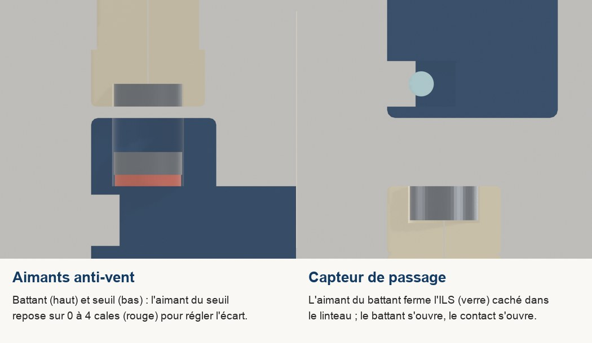

**Wind-proof magnets.** A Ø6 × 2 magnet sits flush under each flap, 20 mm from the free
edge. Another one sits right below it in a 6 mm well in the sill. **Printed 1 mm shims**
(plate 07) set the gap between the two magnets:

| Shims under the sill magnet | 0 | **1 (start)** | 2 | 3 | 4 |
|---|---:|---:|---:|---:|---:|
| Gap between magnets | 5 mm | **4 mm** | 3 mm | 2 mm | 1 mm |
| Feel | almost nothing | holds against a breeze | firm | very firm | too hard for a kitten |

Start with one shim and tune on the prototype: the flap should stay closed when you
blow on it and open with a fingertip push. The magnets must **attract**: before gluing,
stack the two magnets of each pair and mark the touching faces with a felt pen, then
fit them marked face to marked face.

**Passage sensor.** A Ø6 × 3 magnet is glued at the top of each flap, and a **reed
switch** (normally open, 2 × 14 mm glass body) lies in the lintel, one end right above
that magnet, 9 mm away. At rest both reed switches are closed. As soon as a flap opens
by about 10°, its reed switch opens and the ESP counts a passage. Both reed switches
are wired in series on a single input (`GPIO 5`).

## RGB lighting, sensor and ESP32

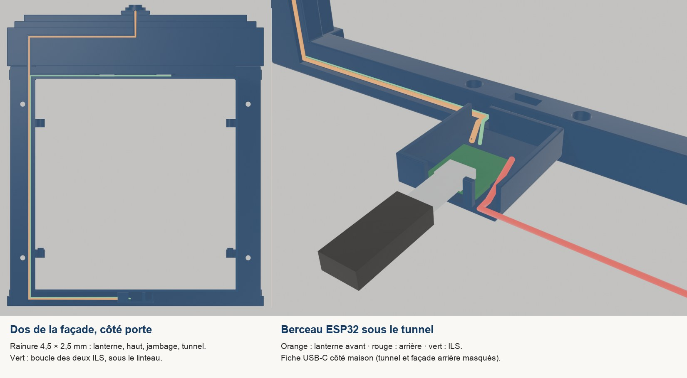

- **4.5 × 2.5 mm cable groove** on the back of each front, against the door, so it is
  invisible. It starts at the lantern foot, runs along the top under the cornice, down
  one side post between the tunnel and the M4 screws, then back under the tunnel. It
  holds the 3 wires of one lantern and, on the front side, the 2 sensor wires.
- **Sensor groove** under the front lintel: it links both reed pockets to the side
  post.
- **ESP cradle** (34 × 39 × 10 mm, plate 07): it sits under the tunnel, held between the
  two fronts. It has a notch per cable and a slot for the USB-C plug, which connects
  through a window at the bottom of the rear front, on the indoor side.

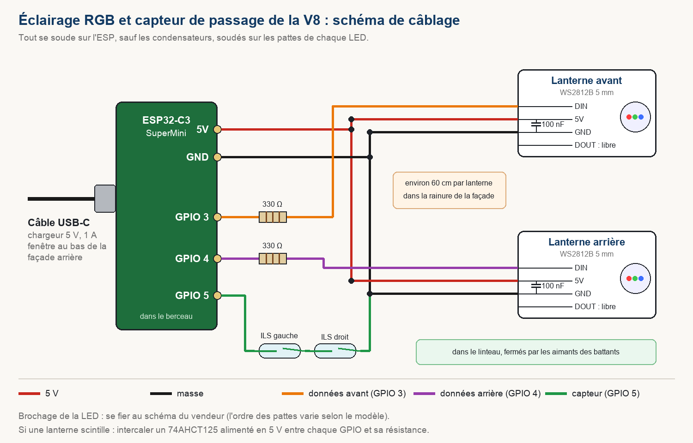

### Wiring

1. **LED.** Find the pinout on your seller's datasheet (DIN, 5 V, GND, DOUT: the order
   varies). Cut DOUT short and insulate it. Bend the legs 2 mm under the LED, solder the
   100 nF capacitor across 5 V and GND (an 0805 SMD part is easiest), then the three
   wires, and heat-shrink. All of this fits in the **connection chamber** under the LED,
   in the lantern foot (9 × 13.5 mm, 5 mm high, with a pointed roof that prints without
   support). It opens into the groove of the front.

   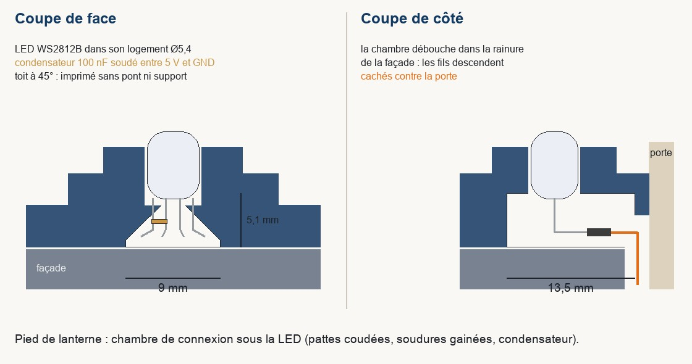

2. **Lanterns → ESP.** 5 V to `5V`, ground to `GND`, data through a 330 Ω resistor
   soldered at the ESP end: front lantern on `GPIO 3`, rear lantern on `GPIO 4`.
3. **Reed switches.** Cut the legs to 5 mm and solder without heating the glass for more
   than 3 s (use pliers as a heat sink). Wire both reed switches in series: one end to
   `GPIO 5`, the other to `GND`. Heat-shrink every joint.
4. **Bench test** before gluing anything: the lanterns light up, and moving a magnet
   past a reed switch changes the sensor state.

If a lantern flickers, add a 74AHCT125 powered from 5 V between each `GPIO` and its
resistor. It can be glued in the free space at the front of the cradle.

### Software: ESPHome (recommended) or WLED

**ESPHome** handles both the lanterns and the sensor. The configuration is ready:
[esphome/chatiere-tardis.yaml](esphome/chatiere-tardis.yaml), validated with
`esphome config`. It provides (entity names in French):

- two RGB lights ("Lanterne avant", "Lanterne arrière") with breathing, beacon, flash,
  candle and colour-cycle effects;
- a "Passage du chat" sensor (open during a passage) and a "Passages" counter, kept
  across reboots;
- a "Flash au passage" switch: the lanterns flash for 3 s on every passage;
- a button to reset the counter.

Getting started:

1. Install ESPHome: Home Assistant add-on, or `pip install esphome`.
2. Copy [`esphome/secrets.yaml.example`](esphome/secrets.yaml.example) to `secrets.yaml`
   and fill it in: Wi-Fi, API encryption key (`openssl rand -base64 32`), OTA and
   fallback hotspot passwords. Never commit this file.
3. Plug the ESP in over USB and run `esphome run chatiere-tardis.yaml`.

Home Assistant then discovers the cat door: notifications, passage history, lights on
at sunset.

**WLED** is fine if you only want the lights; the sensor is then unused. Declare two
WS281x outputs of 1 LED on GPIO 3 and 4, GRB order (RGB for PL9823 LEDs).

## Door template

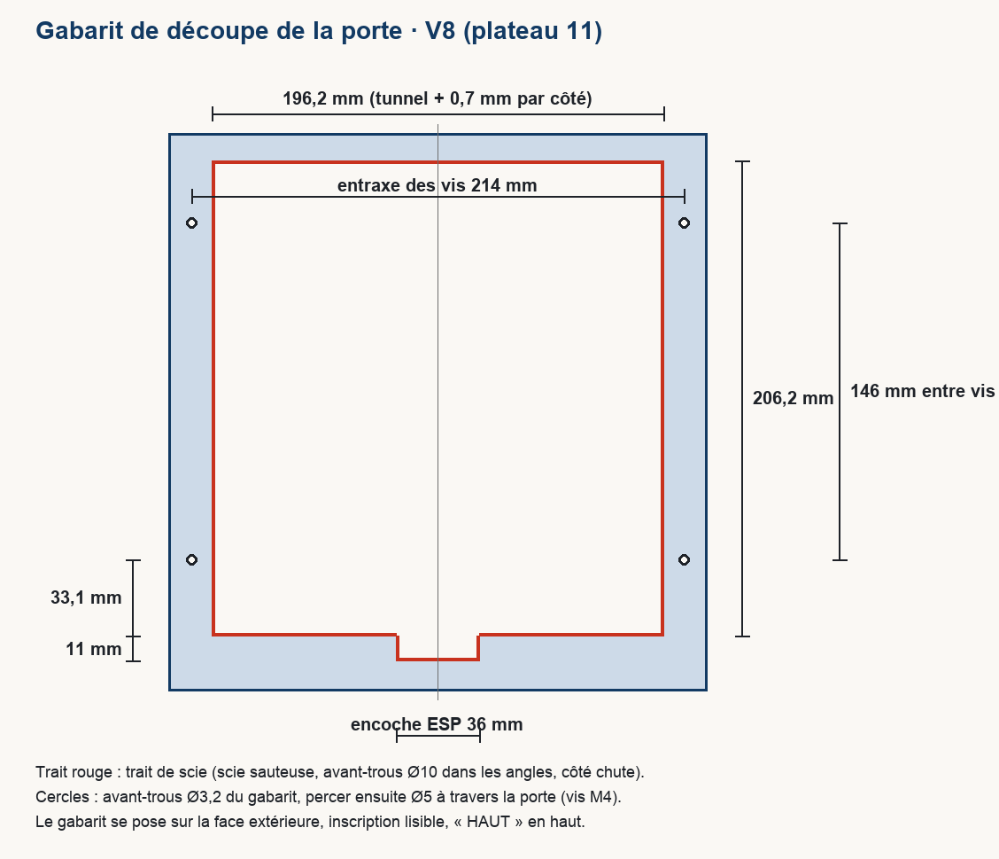

Plate 11 prints a **3 mm template** (234 × 242 mm). Its window is exactly the saw line:
tunnel plus 0.7 mm per side, plus the 36 × 11 mm ESP notch. It also carries the four
pilot holes of the M4 screws and notches marking the vertical centre line.

1. Draw the vertical centre line of the cat door on the outside face of the door and
   choose the height (bottom of the tunnel 10–15 cm above the floor for an adult cat).
2. Lay the template with "HAUT" (top) at the top and the notches on the line. Hold it
   with masking tape.
3. Trace the inside of the window with a sharp pencil and mark the four pilot holes.
4. Drill Ø10 in each corner, on the waste side. Cut with a jigsaw staying on the line,
   then drill the four holes Ø5 right through, square to the door.
5. Offer up the tunnel: it should slide in without force, with an even gap.

## Assembly video

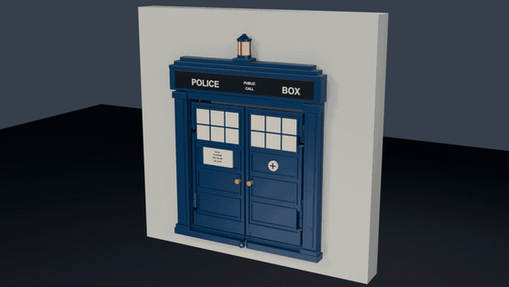

[MP4 assembly video, English captions](visualisations/montage_complet_V8_en.mp4) (78 s,
1280 × 720), also available
[with French captions](visualisations/montage_complet_V8.mp4): fifteen steps, each with
its own camera move and labels on the parts. Cams, magnets, sensor and lock are shown
close up in ghost view (front and flaps see-through). You also see a passage being
detected (lanterns flash) and the gravity return.

## The 12 plates

Each plate is a ready-to-slice **Creality Print project**:

- parts lie flat, decorated side up; screw caps lie head down (smooth visible face),
  the lock blade and TPU stops lie flat (layers along the load, no thin standing wall);
- colours are already assigned to the four CFS slots;
- the prime tower is placed away from the parts;
- the only supports needed are already set, under the axle sleeves;
- small parts, and parts taller than they are wide (pins, cams, shims, lock, diffusers,
  cages), get a **5 mm brim** so they stay on the bed. They are at least 13 mm apart so
  neighbouring brims do not fuse.

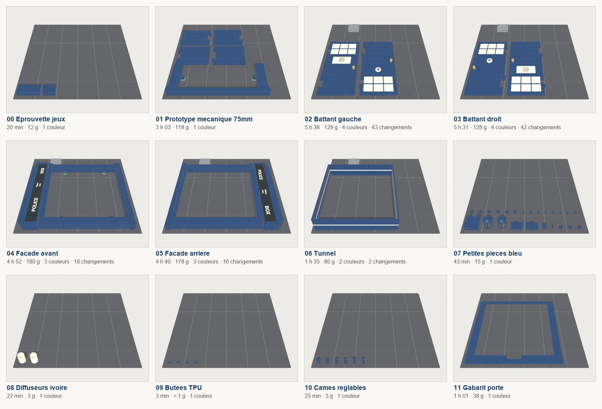

| Plate | Contents | Colours | Changes | Time* | Weight* |
|---|---|---|---:|---:|---:|
| `00_Eprouvette_jeux` | axle, screw, cap, pin, magnet pocket, M3 pilot hole, reed pocket, lock channel, D-key | 1 | 0 | 20 min | 12 g |
| `01_Prototype_mecanique_75mm` | bottom of the frame and flaps at 1:1 scale: cams, lock, magnets | 1 | 0 | 3 h 03 | 118 g |
| `02_Battant_gauche` | front + rear half-shells + 2 pins (left flap) | 4 | 43 | 5 h 37 | 129 g |
| `03_Battant_droit` | same, right flap | 4 | 42 | 5 h 32 | 128 g |
| `04_Facade_avant` | front frame + POLICE BOX sign (black + ivory) | 3 | 16 | 4 h 52 | 180 g |
| `05_Facade_arriere` | same, indoor side, USB-C window | 3 | 16 | 4 h 40 | 178 g |
| `06_Tunnel` | tunnel + ivory trim line | 2 | 2 | 1 h 35 | 80 g |
| `07_Petites_pieces_bleu` | 8 screw caps, lock blade, knob and turn latch, ESP cradle, 8 magnet shims, 2 lantern bases and 2 cages | 1 | 0 | 44 min | 15 g |
| `08_Diffuseurs_ivoire` | 2 lantern diffusers | 1 | 0 | 22 min | 3 g |
| `09_Butees_TPU` | 4 soft stops | TPU | 0 | 3 min | < 1 g |
| `10_Cames_reglables` | 2 × 3.5, 2 × 4.5, 2 × 5.5 mm cams (0.1 mm layers) | 1 | 0 | 26 min | 3 g |
| `11_Gabarit_porte` | cutting and drilling template | 1 | 0 | 1 h 01 | 38 g |

\* Actual **multicolour slicing with Creality Print 7.3.1**, prime tower and supports
included, project presets (K1 Max 0.4 mm, 0.20 mm Standard, Hyper PLA, purge × 1.3).
Total: about 28 h of printing and 880 g of filament, template included.

## Supplies

The full shopping list, with tools, is in
[Printing and assembly](../docs/en/PRINTING_AND_ASSEMBLY.md#shopping-list).

**Axle clips.** Each axle has two clips: one under the frame knuckle, the other above
the flap knuckle, in a recess inside the flap (fitted before gluing the rear
half-shell). Their centres are **38.1 mm** apart on the lower axle and **23.0 mm** on
the upper axle. E-clips need a small groove filed in the rod; push-on Starlock washers
do not.

The M4 screw length matches a 40 mm door. Measure your door before ordering.

## Validate and tune

Before the large parts, print `00_Eprouvette_jeux`, `01_Prototype_mecanique_75mm`,
`10_Cames_reglables` and `07_Petites_pieces_bleu` (lock blade, shims).

1. **Test coupon.** The axle turns freely, the magnet goes in by hand, the blade slides
   in the channel, a cam fits on the D-key, the reed switch fits in its pocket.
2. **Return.** Assemble the prototype with the 4.5 mm cams. Each flap must come back to
   centre by itself, in both directions. Too weak: 5.5 mm cams. Too hard to open:
   3.5 mm.
3. **Magnets.** Start with one shim. Add or remove shims until the flap stays closed
   when you blow on it and opens with one finger, then glue the magnet.
4. **Lock.** LOCKED: no flap may move. FREE: nothing may stick out of the sill.
5. **Sensor.** With a multimeter in continuity mode, check that the reed loop opens as
   soon as a flap opens by a few degrees. If not, move the glass body closer to the
   magnet in its pocket.

## Assembly

Follow along with the [assembly video](visualisations/montage_complet_V8_en.mp4).

1. Cut the door with the template (see above).
2. **Flaps.** Glue the Ø6 × 2 magnet flush under each flap and the Ø6 × 3 magnet at the
   top, minding the marked polarity.
3. **Front.** Fit the shims and glue the sill magnets. Lay the reed switches in their
   lintel pockets (one end above the flap magnet) and their wires in the groove. Route
   the lantern wires and glue the lantern.
4. **Lock.** Slide the blade into its channel from the top, then screw the knob on
   through the slot (M3 × 18). Screw the turn latch into its pilot hole (M3 × 12)
   without tightening: it must turn by hand and stay where you leave it.
5. **Cams and flaps.** Put each cam on its D-key. Slide the axles in from below, fit the
   lower clips then the upper ones. Put the front half-shell on its cam, insert the
   pins and glue the rear half-shell. The flap must rise as it opens and come back to
   centre by itself.
6. **Electronics.** Solder, bench test, stick the ESP into the cradle with double-sided
   tape, USB-C against the slot. Fit the cradle in the door notch.
7. **Tunnel, rear front** (USB-C window facing the socket), M4 screws and caps, TPU
   stops.
8. Flash ESPHome, plug in the charger. Run at least **50 cycles** by hand, FREE and
   LOCKED, before leaving the cat alone with it.

## Main dimensions

- nominal opening: 190 × 200 mm;
- front: 244 mm wide, 314.5 mm with the lantern;
- reference door thickness: 40 mm, adjustable;
- door cut-out: 196.2 × 206.2 mm, plus the 36 × 11 mm ESP notch;
- free swing: −80° to +80°, cushioned towards ±85°;
- centre gap: 2.4 mm.

## Validation

| Check | Result |
|---|---|
| Meshes | 76 closed volumes, no bad edge |
| Plates | 12 3MF + reference assembly, read by lib3mf without warning |
| Assembly | no nominal interference, including magnets, reed switches, lock and cradle |
| Swing | −80° to +80° in 5° steps, **for each of the three cams**, flap lifted: no collision |
| Cam envelope | minimum clearance 0.3 mm and contact on the ±60° lines, for 3.5, 4.5 and 5.5 mm |
| Stops | all 4 TPU stops make contact at ±85° |
| Central lock | LOCKED: each flap blocked from 0.5° in both directions, knob resting on the latch; FREE: blade 1.5 mm below the flaps, latch clear of the knob |
| Magnets | wind gap from 1 to 5 mm depending on shims (4 mm by default); sensor magnet 9 mm from the reed switch |
| ESPHome | `esphome config`: valid configuration |
| Creality Print 7.3.1, GUI | all 12 projects opened and sliced one by one: no warning |
| Creality Print 7.3.1, command line | all 12 plates slice without conflict; every assigned colour is extruded |
| Files | the 3MF files are Creality Print projects as soon as they are generated; `scripts/audit_tours.py` checks every 3MF: native project, prime tower away from the parts |

Still to be validated on a real print: actual clearances, cam sliding and return,
magnet strength, reed switch threshold, gluing, TPU stop durability and cat safety.

## Regenerating

See [Development](../docs/en/DEVELOPMENT.md) for the full list of commands.
In short:

```sh
/Applications/Blender.app/Contents/MacOS/Blender --background --python tardis_v8/generate.py
/Applications/Blender.app/Contents/MacOS/Blender --background --python tardis_v8/verify_geometry.py
.venv/bin/python tardis_v8/verify_3mf.py
python3 scripts/trancher_creality_print.py tardis_v8
python3 scripts/audit_tours.py
```
