# TARDIS Geronimeow V8 — guide complet

**[English version](README.en.md)** · [Accueil du projet](../README.md)

La V8 est la version actuelle de la chatière :

- les battants reviennent au centre **par gravité**, sans ressort ;
- les **cames sont rapportées et interchangeables**, pour régler la force de rappel sans rien réimprimer d'autre ;
- un **verrou central unique** bloque les deux battants avec un seul bouton ;
- des **aimants anti-vent** tiennent les battants fermés, avec un réglage par cales ;
- un **capteur de passage** (ILS) et l'**éclairage RGB** des lanternes sont pilotés par un ESP32 caché sous le tunnel ;
- un **gabarit imprimé** sert à découper la porte.

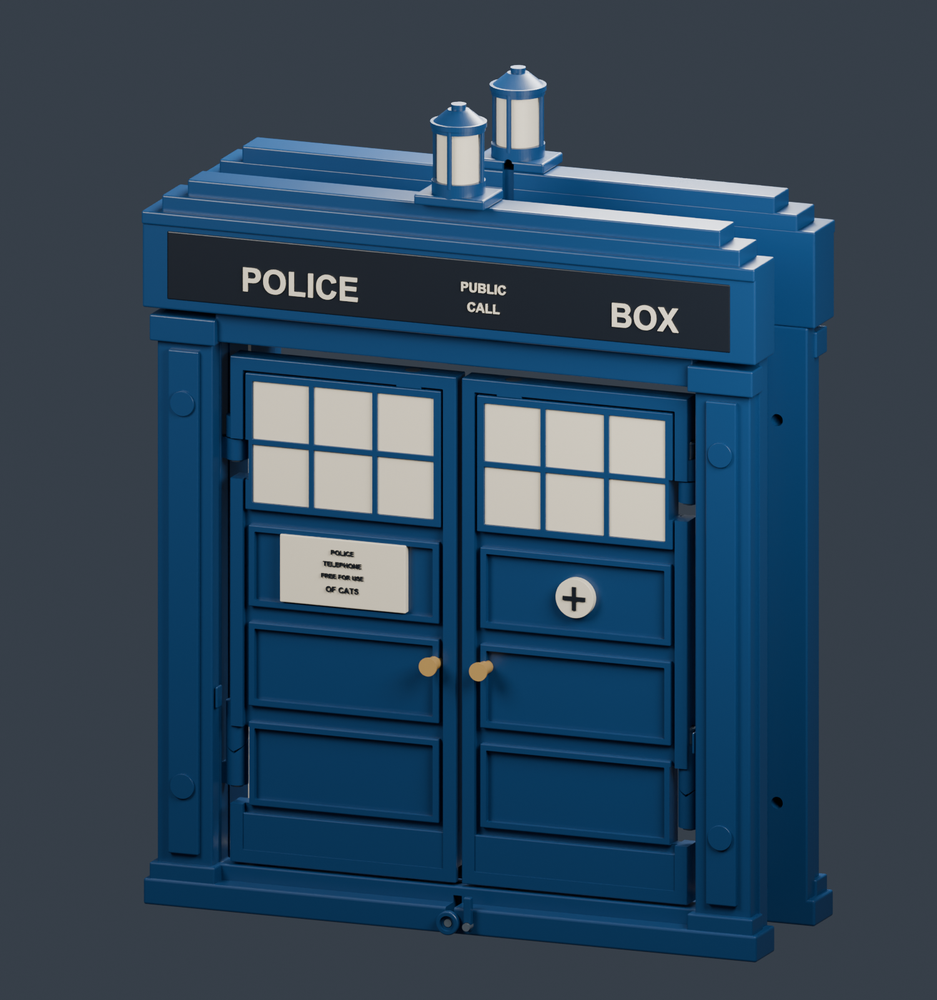

**Pour imprimer : suivre le [guide illustré Creality Print](../docs/GUIDE_CREALITY_PRINT.md).**

> **État :** les 12 plateaux sont prêts à imprimer, et Creality Print 7.3.1 les tranche
> sans avertissement, en ligne de commande comme dans l'interface. Rien n'a encore été
> imprimé : le rappel, les aimants et le capteur se règlent sur le prototype 75 mm (voir
> [Valider et régler](#valider-et-régler)).

| Mode | Entrer | Sortir | Comment |
|---|---:|---:|---|
| LIBRE | oui | oui | bouton du verrou en bas, la lame est sous le seuil |
| FERMÉ | non | non | bouton monté, tourniquet tourné dessous : la lame bloque les deux battants |

## Ce qui change par rapport à la version précédente (V7 Lite)

| V7 Lite | V8 |
|---|---|
| came fondue dans la façade : changer la pente oblige à réimprimer une façade (4 h 50) | **cames rapportées** de 3,5, 4,5 ou 5,5 mm, à changer en quelques secondes (5 min d'impression) |
| deux curseurs et deux pênes acier Ø4 | **un seul bouton** : une lame imprimée monte dans les deux battants |
| rien ne retient les battants contre le vent | **aimants Ø6 × 2** en bas des battants et dans le seuil, écart réglable de 1 à 5 mm |
| pas de détection | **deux ILS** dans le linteau : comptage, notifications, flash des lanternes au passage |
| rainure de câbles 3 × 2 mm | rainure **4,5 × 2,5 mm** : câbles des lanternes et du capteur |
| découpe de la porte à tracer soi-même | **gabarit imprimé** (plateau 11) et figure cotée |
| 10 plateaux | 12 plateaux, dont les cames (couches de 0,1 mm) et le gabarit |

## Le rappel par gravité et les cames réglables

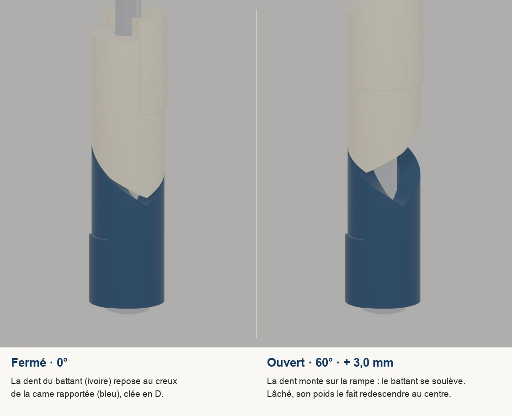

Sous chaque battant, une **came en V** posée sur le nœud du cadre soulève le battant
quand il s'ouvre : de 3 mm à 60° avec la came de 4,5 mm. Lâché, le battant
redescend au creux par son poids, c'est-à-dire fermé, et cela dans les deux sens.

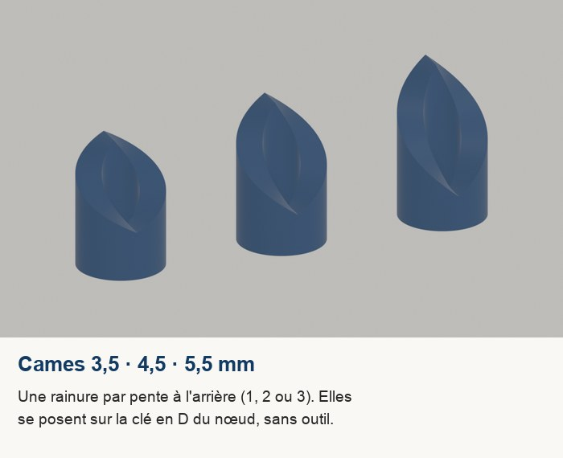

**Le réglage.** La came est une petite pièce enfilée sur l'axe, avec une clé en D
dessous : elle ne peut ni tourner ni se poser à l'envers, et la même came sert à
gauche comme à droite. Trois pentes sont fournies, repérées par 1, 2 ou 3 rainures
à l'arrière :

| Came | Rainures | Levée à 60° | Levée à la butée (85°) | Couple de rappel estimé | Effet |
|---|:---:|---:|---:|---:|---|
| 3,5 mm | 1 | 2,3 mm | 3,3 mm | environ 2,2 mN·m | plus doux |
| **4,5 mm** (montée d'origine) | 2 | 3,0 mm | 4,25 mm | environ 2,8 mN·m | équilibre |
| 5,5 mm | 3 | 3,7 mm | 5,2 mm | environ 3,4 mN·m | retour plus franc |

**Pourquoi la même dent marche avec les trois cames.** Le dessous du nœud du battant
n'est pas la copie d'une seule came. C'est l'enveloppe des trois : pente douce
jusqu'à 60° de part et d'autre du creux, pente raide au-delà. Quelle que soit la came
posée, le battant s'appuie dessus sur les deux lignes à ±60°, à la même hauteur. Il
reste donc toujours au même niveau au repos et monte selon la pente choisie.
`generate.py` vérifie cette propriété pour chaque came et chaque angle (jeu minimal
0,3 mm, voir `cam_envelope` dans `verification.json`).

Les cames s'impriment debout, en **couches de 0,1 mm** et pleines (réglage par objet
déjà dans le projet), pour une rampe lisse. Un peu de graphite sec sur la rampe
réduit le frottement ; éviter la graisse, qui colle la poussière.

## Le verrou central

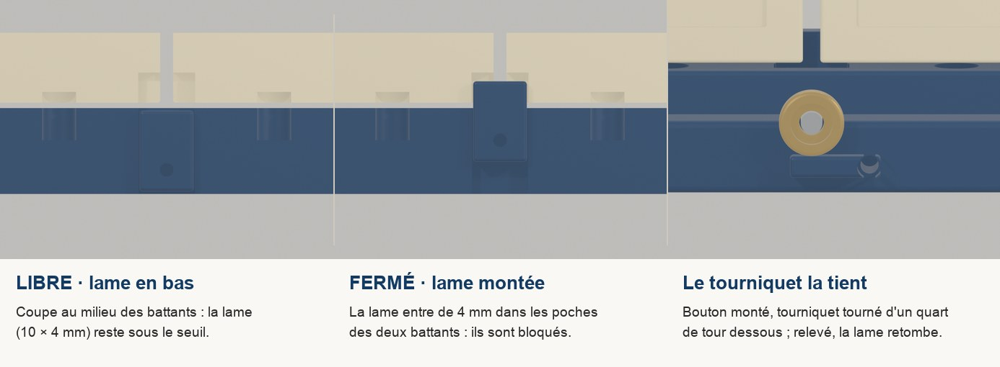

Une **lame imprimée de 10 × 4 mm** coulisse verticalement dans le seuil, au milieu.
Un bouton, vissé dessus par une vis M3 × 18, sort par une fente verticale au bas de
la façade. À côté, un **tourniquet** (petit loquet imprimé qui pivote sur une vis
M3 × 12, comme sur un meuble) tient le bouton en haut :

- **FERMÉ** : monter le bouton, tourner le tourniquet d'un quart de tour vers le centre,
  lâcher : le bouton repose dessus. La lame entre de 4 mm dans une poche au coin bas de
  chaque battant, fermée devant et derrière : les deux battants sont bloqués dans les
  deux sens (contrôle numérique : blocage dès 0,5°).
- **LIBRE** : soulever un peu le bouton, relever le tourniquet, lâcher. La lame retombe
  par son poids sous le seuil, 0,5 mm sous la surface : rien ne dépasse pour le chat.

La lame est guidée à 0,2 mm près et ne bouge que verticalement. La face avant du
canal, imprimée en pont de 10,4 mm (façade posée dos au plateau), a 0,2 mm de jeu en
plus pour qu'un léger affaissement du pont ne la coince pas. C'est le tourniquet,
et non un cran dans la fente, qui la retient : un cran latéral aurait demandé à la
lame de se décaler, ce que son guidage interdit.

Il n'y a plus de pêne acier ni de collier. Le canal de la lame est ouvert dessous, donc
la poussière tombe et ne bloque rien.

## Aimants anti-vent et capteur de passage

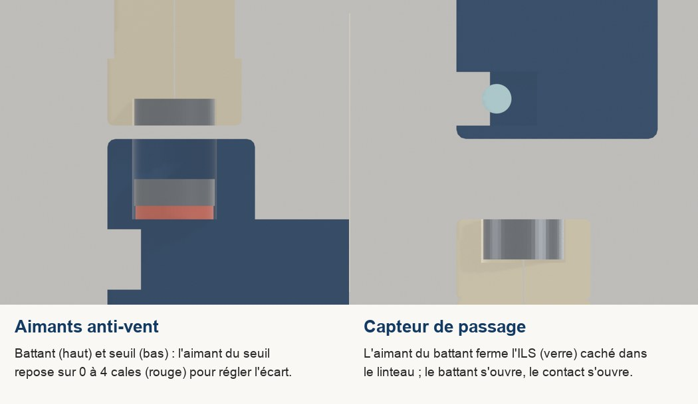

**Aimants anti-vent.** Un aimant Ø6 × 2 affleure sous chaque battant, à 20 mm du bord
libre. Un autre est logé dans le seuil, juste en dessous, dans un puits de 6 mm. Des
**cales imprimées de 1 mm** (plateau 07) règlent l'écart entre les deux aimants :

| Cales sous l'aimant du seuil | 0 | **1 (départ)** | 2 | 3 | 4 |
|---|---:|---:|---:|---:|---:|
| Écart entre aimants | 5 mm | **4 mm** | 3 mm | 2 mm | 1 mm |
| Effet | presque rien | tient contre une brise | ferme | très ferme | trop dur pour un chiot |

Partir d'une cale et régler sur le prototype : le battant doit rester fermé quand on
souffle dessus et s'ouvrir d'une poussée du bout du doigt. Les aimants doivent
**s'attirer** : avant de les coller, empiler les deux de chaque paire et marquer
au feutre les faces qui se touchent, puis les poser face marquée vers face marquée.

**Capteur de passage.** Un aimant Ø6 × 3 est collé en haut de chaque battant, et un
**ILS** (interrupteur à lame souple, ampoule de verre de 2 × 14 mm, normalement ouvert)
est logé dans le linteau, une extrémité juste au-dessus de cet aimant, à 9 mm. Au
repos, les deux ILS sont fermés. Dès qu'un battant s'ouvre d'environ 10°, son ILS
s'ouvre et l'ESP compte un passage. Les deux ILS sont en série sur une seule entrée
(`GPIO 5`).

## Éclairage RGB, capteur et ESP32

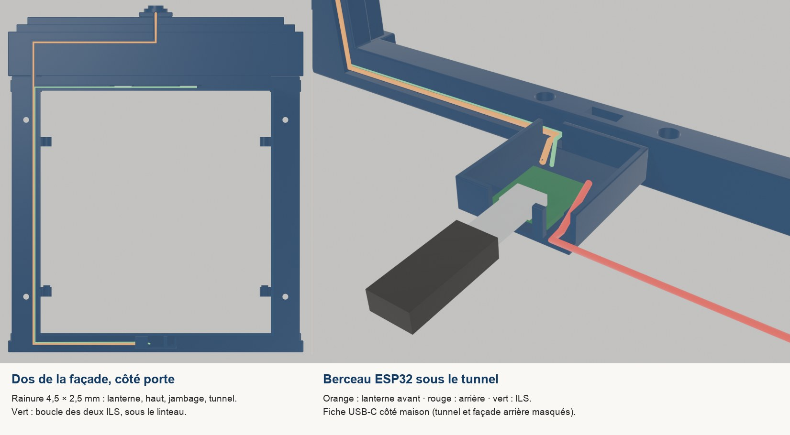

- **Rainure de câbles 4,5 × 2,5 mm** au dos de chaque façade, contre la porte, donc
  invisible. Elle part du pied de la lanterne, passe en haut sous la corniche, descend
  un jambage entre le tunnel et les vis M4, puis revient sous le tunnel. Elle loge les
  3 fils d'une lanterne et, côté avant, les 2 fils du capteur.
- **Rainure du capteur** sous le linteau avant : elle relie les deux poches d'ILS au
  jambage.
- **Berceau ESP** (34 × 39 × 10 mm, plateau 07) : il se loge sous le tunnel, pris entre
  les deux façades. Il a une encoche par câble et une fente pour la fiche USB-C, qui
  se branche par une fenêtre au bas de la façade arrière, côté maison.

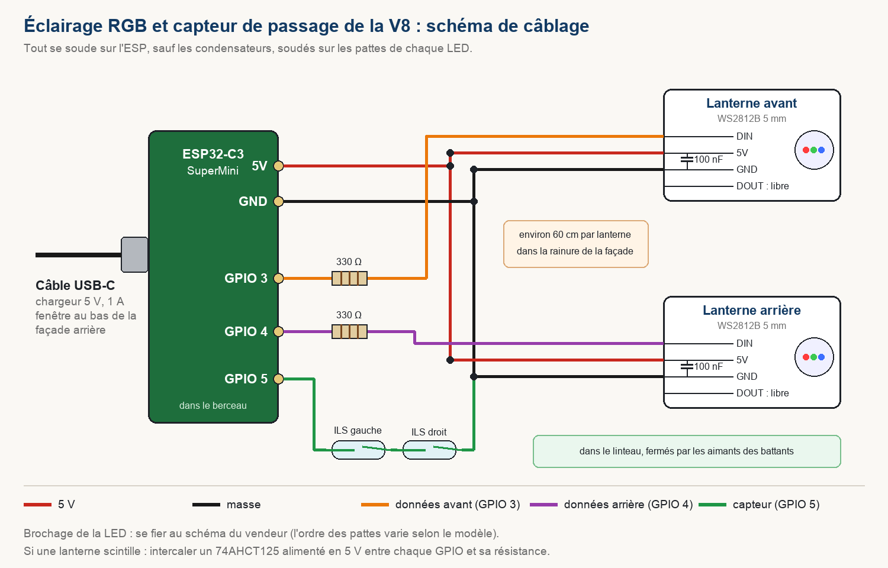

### Câblage

1. **LED.** Repérer le brochage sur la fiche du vendeur (DIN, 5 V, GND, DOUT : l'ordre
   varie). Couper DOUT court et l'isoler. Couder les pattes à 2 mm sous la LED, souder
   le condensateur de 100 nF entre 5 V et GND (un CMS 0805 est le plus simple), puis les
   trois fils, et gainer. Tout cela se loge dans la **chambre de connexion** creusée
   sous la LED, dans le pied de la lanterne (9 × 13,5 mm, 5 mm de haut, toit en pointe
   imprimable sans support). Elle débouche dans la rainure de la façade.

   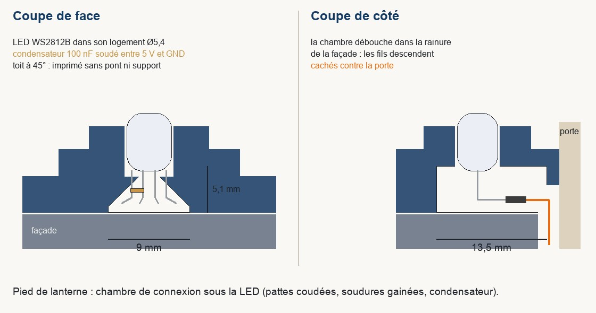

2. **Lanternes → ESP.** 5 V sur `5V`, masse sur `GND`, données par une résistance de
   330 Ω soudée côté ESP : avant sur `GPIO 3`, arrière sur `GPIO 4`.
3. **ILS.** Couper les pattes à 5 mm, souder sans chauffer l'ampoule plus de 3 s (pince
   en dissipateur). Relier les deux ILS en série : un bout sur `GPIO 5`, l'autre sur
   `GND`. Gaine sur chaque soudure.
4. **Essayer sur table** avant de coller quoi que ce soit : les lanternes s'allument,
   et passer un aimant sous un ILS change l'état du capteur.

Si une lanterne scintille, intercaler un 74AHCT125 alimenté en 5 V entre chaque `GPIO`
et sa résistance. Il se colle dans l'espace libre à l'avant du berceau.

### Logiciel : ESPHome (conseillé) ou WLED

**ESPHome** gère à la fois les lanternes et le capteur. La configuration est prête :
[esphome/chatiere-tardis.yaml](esphome/chatiere-tardis.yaml), validée par
`esphome config`. Elle fournit :

- deux lumières RGB (« Lanterne avant », « Lanterne arrière ») avec les effets
  Respiration, Gyrophare, Flash, Bougie et Couleurs ;
- un capteur « Passage du chat » (ouvert pendant un passage) et un compteur
  « Passages », conservé au redémarrage ;
- un interrupteur « Flash au passage » : les lanternes flashent 3 s à chaque passage ;
- un bouton pour remettre le compteur à zéro.

Mise en route :

1. Installer ESPHome : module Home Assistant, ou `pip install esphome`.
2. Copier [`esphome/secrets.yaml.example`](esphome/secrets.yaml.example) en `secrets.yaml`
   et le remplir : Wi-Fi, clé de chiffrement de l'API (`openssl rand -base64 32`), mots
   de passe OTA et du point d'accès de secours. Ce fichier n'est jamais commité.
3. Brancher l'ESP en USB et lancer `esphome run chatiere-tardis.yaml`.

Home Assistant détecte ensuite la chatière : notifications, historique des
passages, allumage au coucher du soleil.

**WLED** convient si on ne veut que les lumières. Le capteur n'est alors pas exploité.
Déclarer deux sorties WS281x de 1 LED sur GPIO 3 et 4, ordre GRB (RGB pour des
PL9823).

## Le gabarit de découpe

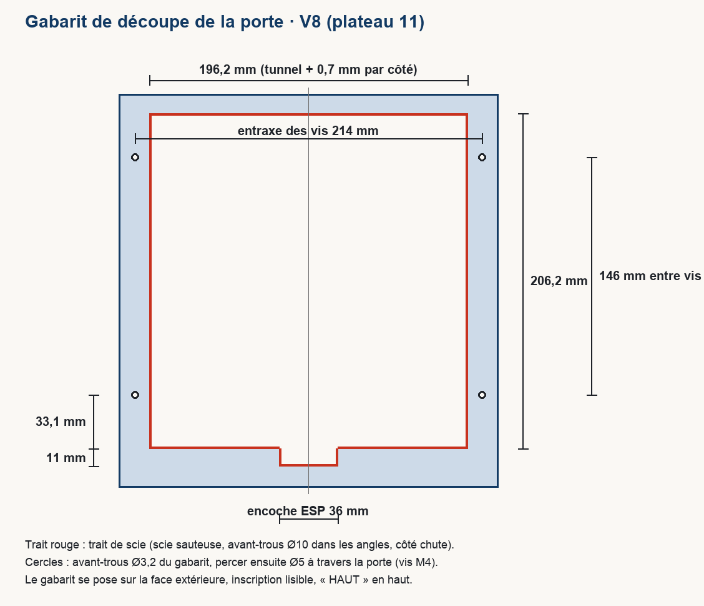

Le plateau 11 imprime un **gabarit de 3 mm** (234 × 242 mm). Sa fenêtre est
exactement le trait de scie : tunnel plus 0,7 mm par côté, plus l'encoche de 36 × 11 mm
de l'ESP. Il porte aussi les quatre avant-trous des vis M4 et des encoches de
repérage de l'axe vertical.

1. Tracer l'axe vertical de la chatière sur la face extérieure de la porte et choisir
   la hauteur (le bas du tunnel à 10–15 cm du sol pour un chat adulte).
2. Poser le gabarit, « HAUT » en haut, encoches sur l'axe. Le fixer au ruban de
   masquage.
3. Tracer l'intérieur de la fenêtre au crayon fin et pointer les quatre avant-trous.
4. Percer Ø10 dans chaque angle, côté chute. Scier à la scie sauteuse en restant sur le
   trait, puis percer les quatre trous à Ø5 de part en part, bien d'équerre.
5. Présenter le tunnel : il doit entrer sans forcer, avec un jeu régulier.

## Le montage en vidéo

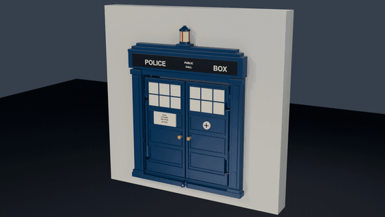

[Vidéo MP4 du montage complet](visualisations/montage_complet_V8.mp4) (78 s, 1280 × 720,
[version sous-titrée en anglais](visualisations/montage_complet_V8_en.mp4)) :
quinze étapes, chacune avec son plan de caméra et des étiquettes sur les pièces. Les
cames, les aimants, le capteur et le verrou sont montrés en gros plan, en vue fantôme
(façade et battants translucides) pour voir l'intérieur. On voit aussi le passage
détecté (flash des lanternes) et le retour par gravité. Détails dans
[visualisations/](visualisations/README.md).

## Les 12 plateaux

Chaque plateau est un **projet Creality Print** prêt à trancher :

- les pièces sont posées à plat, côté décoré vers le haut ; les caches de vis sont
  posés tête sur le plateau (face visible lisse), la lame du verrou et les butées TPU
  sont couchées (couches dans le sens de l'effort, pas de paroi fine debout) ;
- les couleurs sont déjà affectées aux quatre emplacements du CFS ;
- la tour de purge est placée hors des pièces ;
- les seuls supports nécessaires sont prévus, sous les fourreaux d'axe ;
- les petites pièces et les pièces plus hautes que larges (pions, cames, cales, verrou,
  diffuseurs, cages) ont une **bordure de 5 mm** pour ne pas se décrocher du plateau.
  Elles sont espacées d'au moins 13 mm : deux bordures voisines ne se soudent pas.

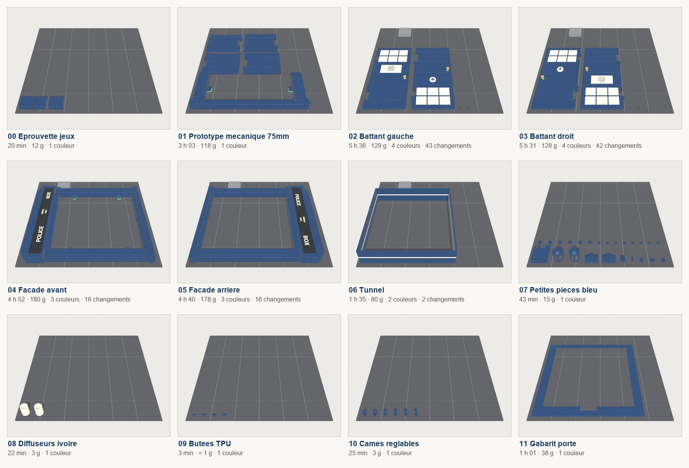

| Plateau | Contenu | Couleurs | Changements | Temps* | Masse* |
|---|---|---|---:|---:|---:|
| `00_Eprouvette_jeux` | axe, vis, cache, pion, logement d'aimant, avant-trou M3, poche d'ILS, canal du verrou, clé en D | 1 | 0 | 20 min | 12 g |
| `01_Prototype_mecanique_75mm` | bas du cadre et bas des battants à l'échelle 1:1 : cames, verrou, aimants | 1 | 0 | 3 h 03 | 118 g |
| `02_Battant_gauche` | demi-coque avant + arrière + 2 pions | 4 | 43 | 5 h 37 | 129 g |
| `03_Battant_droit` | idem | 4 | 42 | 5 h 32 | 128 g |
| `04_Facade_avant` | cadre + enseigne POLICE BOX (noir + ivoire) | 3 | 16 | 4 h 52 | 180 g |
| `05_Facade_arriere` | idem, face intérieure, fenêtre USB-C | 3 | 16 | 4 h 40 | 178 g |
| `06_Tunnel` | tunnel + filet ivoire | 2 | 2 | 1 h 35 | 80 g |
| `07_Petites_pieces_bleu` | 8 caches de vis, lame, bouton et tourniquet du verrou, berceau ESP, 8 cales d'aimant, 2 bases et 2 cages de lanterne | 1 | 0 | 44 min | 15 g |
| `08_Diffuseurs_ivoire` | 2 diffuseurs de lanterne | 1 | 0 | 22 min | 3 g |
| `09_Butees_TPU` | 4 butées souples | TPU | 0 | 3 min | < 1 g |
| `10_Cames_reglables` | 2 cames de 3,5, 2 de 4,5, 2 de 5,5 mm (couches de 0,1 mm) | 1 | 0 | 26 min | 3 g |
| `11_Gabarit_porte` | gabarit de découpe et de perçage | 1 | 0 | 1 h 01 | 38 g |

\* Tranchage **multicolore réel avec Creality Print 7.3.1**, tour de purge et supports
compris, préréglages des projets (K1 Max 0,4 mm, 0,20 mm Standard, Hyper PLA, purge × 1,3).
Total : environ 28 h d'impression et 880 g de filament, gabarit compris.

## Fournitures

| Qté | Fourniture |
|---:|---|
| 2 + 2 | tiges acier Ø3 mm coupées à **39,4 mm** (axes bas) et **24,3 mm** (axes hauts) |
| 8 | clips pour axe Ø3 mm : e-clips DIN 6799 taille 2,3 ou rondelles Starlock Ø3 |
| 4 | aimants néodyme **Ø6 × 2 mm**, N35 conseillé (anti-vent : bas des battants et seuil) |
| 2 | aimants néodyme **Ø6 × 3 mm** (capteur : haut des battants) |
| 2 (+1) | ILS normalement ouverts, ampoule de verre **2 × 14 mm**, 10 à 20 AT |
| 1 + 1 | vis M3 × 18 (bouton du verrou) et M3 × 12 (pivot du tourniquet) |
| 4 | vis M4 × 70 tête basse, rondelles et écrous M4 |
| — | colle cyanoacrylate et colle pour PLA, double face mousse, gaine thermo ; graphite sec en option |

Pour l'éclairage et le capteur, il faut en plus :

| Qté | Fourniture |
|---:|---|
| 1 | ESP32-C3 SuperMini (22,5 × 18 mm, USB-C) |
| 2 (+1) | LED RGB adressables 5 mm WS2812B F5 |
| 2 | résistances 330 Ω |
| 2 | condensateurs céramique 100 nF (CMS 0805 conseillé, logés dans le pied des lanternes) |
| 2 × 60 cm | fil fin 3 conducteurs AWG 28 à 30 (une lanterne chacun) |
| 60 cm | fil fin 2 conducteurs AWG 28 à 30 (boucle des ILS) |
| 1 | câble USB-C et chargeur 5 V, 1 A |
| en option | module 74AHCT125, si une lanterne scintille |

**Clips d'axe.** Chaque axe porte deux clips : un sous le nœud du cadre, l'autre au-dessus
du nœud du battant, dans un logement intérieur au battant (posé avant de coller la
demi-coque arrière). Leurs centres sont espacés de **38,1 mm** sur l'axe bas et de
**23,0 mm** sur l'axe haut. Des e-clips demandent une petite gorge à la lime ; des
rondelles Starlock à pousser n'en demandent pas.

La longueur M4 correspond à une porte de 40 mm. Mesurer la porte avant de commander.
La liste complète, avec l'outillage, est aussi dans
[Impression, fournitures et montage](../docs/IMPRESSION_ET_MONTAGE.md#liste-dachat).

## Valider et régler

Avant les grandes pièces, imprimer `00_Eprouvette_jeux`, `01_Prototype_mecanique_75mm`,
`10_Cames_reglables` et `07_Petites_pieces_bleu` (lame du verrou, cales).

1. **Éprouvette.** L'axe tourne librement, l'aimant entre à la main, la lame coulisse
   dans le canal, une came s'emboîte sur la clé en D, l'ILS entre dans sa poche.
2. **Rappel.** Monter le prototype avec les cames de 4,5 mm. Chaque battant doit
   revenir seul au centre, dans les deux sens. Trop mou : cames de 5,5 mm. Trop dur à
   ouvrir : 3,5 mm.
3. **Aimants.** Commencer avec une cale. Ajouter ou retirer des cales jusqu'à ce que le
   battant reste fermé au souffle et s'ouvre d'un doigt, puis coller l'aimant.
4. **Verrou.** En FERMÉ, aucun battant ne doit bouger. En LIBRE, rien ne doit dépasser
   du seuil.
5. **Capteur.** Avec un multimètre en continuité, vérifier que la boucle des deux ILS
   s'ouvre dès qu'un battant s'ouvre de quelques degrés. Sinon, rapprocher l'ampoule
   de l'aimant dans sa poche.

## Montage

À suivre avec la [vidéo de montage](visualisations/montage_complet_V8.mp4).

1. Découper la porte au gabarit (voir plus haut).
2. **Battants.** Coller l'aimant Ø6 × 2 sous chaque battant (affleurant) et l'aimant
   Ø6 × 3 en haut, en respectant la polarité notée.
3. **Façade avant.** Poser les cales et coller les aimants du seuil. Coucher les ILS dans
   leurs poches du linteau (une extrémité au-dessus de l'aimant du battant), et leurs
   fils dans la rainure. Passer les fils de la lanterne et la coller.
4. **Verrou.** Glisser la lame dans son canal par le haut, puis visser le bouton à
   travers la fente (M3 × 18). Visser le tourniquet sur son avant-trou (M3 × 12), sans
   serrer : il doit tourner au doigt et rester en place.
5. **Cames et battants.** Poser chaque came sur sa clé en D. Glisser les axes par le
   bas, poser les clips du bas puis ceux du haut. Poser la demi-coque avant sur sa came,
   placer les pions et coller la demi-coque arrière. Le battant doit monter en
   s'ouvrant et revenir seul au centre.
6. **Électronique.** Souder, essayer sur table, coller l'ESP au double face dans le
   berceau, USB-C contre la fente. Poser le berceau dans l'encoche de la porte.
7. **Tunnel, façade arrière** (fenêtre USB-C en face de la prise), vis M4 et caches,
   butées TPU.
8. Charger ESPHome, brancher le chargeur. Faire au moins **50 cycles** à la main, en
   LIBRE et en FERMÉ, avant de laisser le chat seul.

## Dimensions principales

- passage nominal : 190 × 200 mm ;
- façade : 244 mm de large, 314,5 mm avec la lanterne ;
- épaisseur de porte de référence : 40 mm, paramétrable ;
- découpe de la porte : 196,2 × 206,2 mm, plus l'encoche de l'ESP de 36 × 11 mm ;
- ouverture libre : −80° à +80°, amortie vers ±85° ;
- jeu central : 2,4 mm.

## Validation

| Contrôle | Résultat |
|---|---|
| Volumes | 76 volumes fermés, aucune arête défectueuse |
| Plateaux | 12 3MF + assemblage de référence, lus sans avertissement par lib3mf |
| Assemblage | aucune interférence nominale, aimants, ILS, verrou et berceau compris |
| Débattement | −80° à +80° par pas de 5°, **pour chacune des trois cames**, battant soulevé : aucune collision |
| Enveloppe des cames | jeu minimal de 0,3 mm et contact sur les lignes à ±60°, pour 3,5, 4,5 et 5,5 mm |
| Butées | contact des 4 butées TPU à ±85° |
| Verrou central | FERMÉ : chaque battant bloqué dès 0,5° dans les deux sens, bouton posé sur le tourniquet ; LIBRE : lame 1,5 mm sous les battants, tourniquet relevé hors du bouton |
| Aimants | écart anti-vent de 1 à 5 mm selon les cales (4 mm d'origine) ; aimant de capteur à 9 mm de l'ILS |
| ESPHome | `esphome config` : configuration valide |
| Creality Print 7.3.1, interface | les 12 projets ouverts et tranchés un par un : aucun avertissement |
| Creality Print 7.3.1, ligne de commande | les 12 plateaux se tranchent sans conflit ; chaque couleur affectée est extrudée |
| Fichiers | les 3MF sont des projets Creality Print dès leur génération ; `scripts/audit_tours.py` contrôle tous les 3MF du dépôt : projets natifs, tours de purge hors des pièces |

Restent à valider sur le prototype : jeux réels, glissement et rappel de la came,
force des aimants, seuil des ILS, collage, tenue des butées TPU et sécurité du chat.

## Régénérer

```sh
/Applications/Blender.app/Contents/MacOS/Blender --background --python tardis_v8/generate.py
/Applications/Blender.app/Contents/MacOS/Blender --background --python tardis_v8/verify_geometry.py
.venv/bin/python tardis_v8/verify_3mf.py
python3 scripts/exporter_projets_creality.py tardis_v8
python3 scripts/trancher_creality_print.py tardis_v8
/Applications/Blender.app/Contents/MacOS/Blender --background --python scripts/render_came.py -- tardis_v8
.venv/bin/python scripts/planche_came.py tardis_v8
/Applications/Blender.app/Contents/MacOS/Blender --background --python scripts/render_details_v8.py -- tardis_v8
.venv/bin/python scripts/planche_details_v8.py tardis_v8
/Applications/Blender.app/Contents/MacOS/Blender --background --python scripts/render_cablage.py -- tardis_v8
.venv/bin/python scripts/planche_cablage.py tardis_v8
.venv/bin/python scripts/schema_eclairage.py tardis_v8
.venv/bin/python scripts/figure_gabarit.py tardis_v8
```
